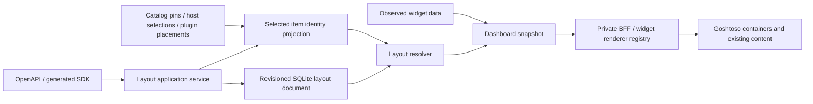

# Spec 001: Homepage groups, layouts and ordering

Status: reviewed implementation contract; implementation in progress. No endpoints,
migrations or library capabilities described as proposed are implemented by this document.
Date: 2026-11-01. Owner: Balemoh. Release stage: pre-v0.1.0, current host release v0.0.8.
Current milestone: implement the first complete instance-wide layout editor and API against verified Goshtoso v0.5.0.
Trust boundary: the existing private operator API/BFF, not a new public write surface.

## 1. Purpose and references

Treat every selected dashboard widget as a presentation-independent item. Users can
mix those items in named groups, arrange groups on the homepage, independently
arrange items inside each group, and override alphabetical order. API clients can
perform every persisted operation without using the browser.

Related existing contracts:

- [Homepage widgets](../../superpowers/specs/2026-10-14-home-widgets-design.md).
- [Plugin system](../../superpowers/specs/2026-10-25-plugin-system-design.md).
- [Instance themes](../../themes.md).
- [OpenAPI](../../../api/openapi.yaml), currently without these layout routes.
- [Goshtoso capability assessment](goshtoso-capabilities.md).
- [UI and acceptance ledger](ui-acceptance.md).

Baseline: Balemoh `6455744557a447f2381f3eecd0a601f60e945a5e`.
The local HTML study v3 is research evidence, not a production component or API.
Its colon-separated sample IDs, fixed 15-item inventory, raw controls and simplified
revision envelope are not imported into this contract.

## 2. Scope and exclusions

First implementation supports page Stack/Grid/Masonry and per-group
Stack/Grid/Masonry, mixed item kinds, alphabetical/custom ordering, drag/drop,
keyboard movement, explicit move controls, group CRUD, preview, Save/Cancel,
conflict recovery, restart persistence and API-first configuration.

Tabs remain a subsequent view option; they do not create new membership.
Arbitrary nested groups, absolute coordinates, repeated appearances of one item,
personal dashboards, selection/pin replacement, new telemetry collection, executable
layout content, new widget renderers, renderer selection and equal-height/stretch controls are
excluded. Container geometry preserves natural renderer-owned height. Provider-supplied
`presentation` remains read-only for this slice. Current production kinds have one
registered renderer each, so no API-owned renderer capability registry or
`itemPresentationOverrides` field is introduced. The existing renderers remain
valid; a layout setting never turns a host panel or plugin chart into a service row.

## 3. Ownership and topology

| Owner | Responsibility |
|---|---|
| Existing providers/catalog/telemetry/plugins | Source identity, data, pin/selection and plugin-placement lifecycle |
| `internal/application/dashboard` | Layout types, canonical ordering, validation, resolution and desired-state commands; no templ/HTTP/SQLite imports |
| SQLite adapter | Atomic compare-and-swap of one instance layout document |
| HTTP/OpenAPI/generated client | Data-only wire contract, preconditions, errors, size limits and SDK |
| BFF | Authorized operator orchestration, drafts and renderer composition through the SDK |
| Goshtoso | Generic container geometry and accessible movement interaction |
| Balemoh UI | Domain group labels, membership, draft state, Save/Cancel and API commands |

`components.Component.Kind()` in Goshtoso identifies a component type. It is not a
widget-instance ID. Balemoh's generic `Widget` already contains ID, source identity,
kind, presentation and data; the UI's widget contains arbitrary `templ.Component`.
Reuse that separation. Do not introduce a required Card interface.

## 4. Entities and persisted document

The proposed wire schema is `schemaVersion: 1`; HTML `proposalVersion` is not a wire field.

| Entity | Persisted fields and meaning |
|---|---|
| Layout document | Schema version, homepage container settings, group definitions, parent ordering rules, explicit item memberships and source-default mapping |
| Group | Stable ID, editable title, heading visibility, initial collapse state, inner layout and membership references |
| Container layout | `type: stack|grid|masonry`, maximum `columns`, `gapPx` |
| Placement | Parent-owned reference. Homepage placement references group ID and required `span: auto|full`; group membership references widget ID |
| Ordering | `mode: alphabetical|custom`; custom `ids` ranks a prefix of that parent's members |
| Widget reference | Existing `GET /api/v1/dashboard` widget ID; no copied payload, secret, rendered HTML or source configuration |

Preserve existing widget IDs, currently `sourceKind + "-" + sourceId`. Plugin widget
identity continues to include its existing placement UUID. Do not derive identity
from a title, renderer, group or position. New user groups use client-selected UUIDs;
reserved `builtin:hosts`, `builtin:services`, `builtin:widgets` identify defaults.
Titles may duplicate. IDs may not duplicate.

The singleton document has an independent nonnegative decimal-string revision,
canonical `0|[1-9][0-9]*`, within signed 64-bit storage range. Read revision
`"0"` supplies virtual initial groups without writing storage. The initial groups
are Hosts, Services and Widgets, alphabetical by title; items are alphabetical
within each. Initial membership uses `host`, `service` and all other source kinds.
First successful change creates revision `"1"`. Themes and selection state do not
share the layout revision.

Explicit memberships are optional overrides. A newly selected item without an
explicit membership enters its mapped source-default group. Unknown source kinds
use the `other` mapping. Renaming a group keeps its identity and source mapping.
Removing an override returns the item to its source default; it does not unpin it.

A widget appears in exactly one resolved group. Explicit membership wins over a
default. There is no second pin/selection database. A layout document may retain a
reference to an item that was previously configured but is now unselected; that
reference is dormant and restores its group on reselection. Intentionally unselected
items are not rendered. A selected item whose provider fails remains visible in
its group, with retained content or an unavailable placeholder.

New references must identify locally eligible selected items as defined below. Existing saved references may
remain when the source is absent. Unknown newly invented IDs are rejected. The
selected-identity projection preserves each source owner's eligibility rules:

| Source | Active eligibility, using local storage only |
|---|---|
| Service | Pinned and `Candidate.Status() == "live"`, exactly as current `Catalog.ListHomepage`; hidden/missing pinned candidates remain excluded |
| Host | Saved dashboard host selection, even if telemetry expired or is absent |
| Plugin | Enabled saved plugin placement, even when connection/runtime observations are unavailable |

Do not equate a retained pin preference with active homepage eligibility. A hidden
or missing service is dormant, not an active placeholder. Provider-read failure is
different from a successful local lifecycle read excluding a service. On provider
failure, active eligibility remains determined by the owning local state above.

The application port for this projection returns data-only identity descriptors
`{id, sourceKind, sourceId, kind, presentation, title, active}` for current active
items and requested prior references. Built-in adapters reuse the source owner's
eligibility and default widget-kind/presentation mapping. A missing descriptor for
an existing dormant reference resolves by saved ID with active=false. No collector,
plugin process, renderer capability discovery or second selection store is involved.
When active identity exists but current provider data does not, the dashboard flat
items include a named unavailable widget descriptor with empty data and an error,
so active resolved groups never point to absent flat IDs, including from cold start.
The existing unknown/unavailable renderer fallback handles that content state.

## 5. Ordering contract

Ordering is parent-scoped placement state, not a global property of source data.

1. Alphabetical means Unicode NFKC normalization followed by Unicode default case
   folding, compared by normalized UTF-8 bytes. Equal names use original stable ID
   bytes as the final tie-break. The server computes this order with the pinned Go
   `x/text` version; it is deterministic and does not use browser locale ordering.
   Locale-specific collation is outside this first version.
2. Custom mode resolves ranked IDs in their stored sequence, followed by unranked
   members in the same alphabetical order. Newly selected members join that tail.
3. IDs cannot repeat or rank a member of another parent. A ranked widget must also have an explicit membership
   reference in that same group. An alphabetical rule has
   an empty `ids` array. Full-document writes may preserve a partial custom prefix.
4. Targeted **custom** order writes submit every current resolved member of that parent
   once. Targeted alphabetical reset submits `ids: []`, never the member list.
   A changed complete member-ID set returns `409 membership_changed`; it is not silently
   accepted as a partial sequence. The comparison and mutation share the storage
   transaction with local selection reads. This serializes pin/disable writes too.
5. Targeted custom ordering materializes references for formerly default-assigned
   members in that group. Alphabetical reset clears ranks but need not remove those
   membership references. Group ordering uses every configured group, including empty groups.
6. Dragging or moving earlier/later resolves the current sequence, moves the chosen
   ID and stores a custom sequence. Reset to alphabetical clears that override.
7. Renaming changes position in alphabetical mode. Custom ranks remain stable.
8. Moving to another group without an anchor preserves its ordering mode and joins
   its unranked tail. Supplying `beforeItemId` places immediately before that member
   and establishes a complete custom destination sequence; explicit JSON null means
   append. The source loses the departed rank. Reordering never changes the renderer.

Canonical order is computed in the API resolver. The production editor uses the
preview API for canonical draft ordering; it does not duplicate the comparator in
JavaScript. Failed-provider item titles use retained metadata when available and
widget ID otherwise. Source-title changes can change alphabetical order without
changing the stored layout revision. Service lifecycle exclusion, host telemetry
absence and provider-read failure follow the distinct eligibility rules above.

## 6. Proposed API

All routes below are additions. Existing dashboard and source-selection routes remain.

| Method and route | Operation |
|---|---|
| `GET /api/v1/dashboard/layout` | Get stored/virtual configuration and revision, with strong ETag `"layout-N"` |
| `PUT /api/v1/dashboard/layout` | Replace the entire document atomically, including group CRUD, layouts, source defaults, membership, order |
| `POST /api/v1/dashboard/layout/preview` | Validate and canonically resolve an unsaved document against current local identities, without persistence |
| `PUT /api/v1/dashboard/layout/order` | Set homepage group ordering using `{mode, ids}` |
| `PUT /api/v1/dashboard/layout/groups/{groupId}/order` | Set this group's item ordering using `{mode, ids}` |
| `PUT /api/v1/dashboard/layout/items/{itemId}/placement` | Move using `{groupId, beforeItemId?}`; path uses the complete percent-encoded existing widget ID |

No UI-only persistence route exists. BFF form submissions call the same generated
SDK operations. Full-document replacement is sufficient for group creation, rename
and removal; targeted routes are convenience commands over the same application service.

All writes require one exact current `If-Match: "layout-N"`. Wildcards, weak tags
and multiple tags are rejected. GET is configuration-only: its ETag is not reused
for a response that changes with live widget data. Preview returns no-store JSON
with canonical document, resolved groups/item IDs, current layout revision and
selected-identity membership token. It does not advance revision or emit success writes.

`GET /api/v1/dashboard` adds optional `layoutRevision` and `groups`, with active-only ordered
group references and ordered item IDs, while retaining its existing flat `items`
and `unavailable` fields. Existing flat items and selection semantics remain compatible.
The BFF renders resolved groups using one snapshot, rather than fetching per item.
The snapshot is observational, not a cross-provider point-in-time transaction.
No-store applies to configuration, preview, mutations and dashboard data.

Successful mutations return 200 with the canonical document, revision and ETag.
Identical normalized content at the current revision returns that revision unchanged.
Different content advances the revision exactly once. Every write uses a SQLite
transaction and revision predicate. An identical payload with a stale revision
still returns 412; it is not an unconditional replay exception.

After an ambiguous transport result, the client reads configuration. If normalized
saved content equals the attempted document, treat it as confirmed. Otherwise retain
the draft and original expected revision; offer explicit conflict recovery. Never
silently fetch a newer revision and resubmit the old draft.

Full replacement validates final group membership and defaults atomically. The
browser requires an explicit destination before deleting a nonempty group or one
used by source defaults. It constructs one replacement document that moves retained
members and redirects defaults. Removing the final group is invalid. Source data,
pins and plugin-placement configuration remain untouched.

Server-side deletion invariant: for each group absent from the replacement, every
previous explicit widget reference, including dormant references, must occur exactly
once in a surviving group. Every source-default mapping previously targeting it must
explicitly reference a surviving group. A violation returns 422 with no write.
A caller intentionally clearing overrides first issues a separate conditional write
while the source group exists, then deletes it in a later write. Full replacement
cannot combine that intentional reset with deletion ambiguously. Rehoming preserves
the destination's ordering policy; source ranks are not copied as a second policy.

Preview accepts a complete document and the expected layout revision in the body.
It may resolve a stale draft for inspection but reports `stale: true` and disables
Save until the user explicitly reloads; automatic or manual rebase is outside this first slice. A preview is never authority to
bypass the write precondition. Only per-group item-order writes require `If-Dashboard-Membership-Match` in
addition to If-Match. Homepage group-order writes require If-Match alone, because
every group-set change already advances the layout revision. See the exact token
schema below. Both alphabetical reset and custom item-order writes use the token.

### 6.1 Wire representation

[example-layout.json](example-layout.json) is the complete virtual initial document.
`homepage.width` is `full|contained`; contained content has a maximum inline width of
72rem. `homepage.placements` owns group span. Group `placements` owns explicit
widget membership; ordering rules, rather than incidental JSON array order, are
normative. Configuration GET and saved documents serialize groups, homepage placement
references and each group's membership-reference array in stable ascending ID-byte
order. Only `ordering.ids` retains a user sequence. Live labels, provider state,
selected identities and resolved alphabetical order never affect configuration bytes.
The configuration-only strong ETag therefore identifies stable bytes at revision N.
Resolved display order belongs exclusively to preview/dashboard responses.

GET layout returns `{revision, document}` with the document shape in that example.
PUT layout accepts that document directly. Successful writes return the same
`{revision, document}` envelope. Revision is a decimal string outside the document.
Targeted ordering accepts `{mode, ids}`. The widget-move body is as listed above.
All document fields in the example are required; `beforeItemId` is optional only
in the targeted move body;
empty arrays/maps serialize as `[]`/`{}`, never null. Unknown fields are rejected.

Exact wire object shapes, with no additional properties, are:

| Object | Required members | Optional/nullable |
|---|---|---|
| Homepage placement | `{groupId: string, span: "auto"|"full"}` | None |
| Group placement | `{itemId: string}` using exact widget ID | None |
| Ordering | `{mode: "alphabetical"|"custom", ids: string[]}` | None; alphabetical requires `[]` |
| Group | `id`, `title`, `layout`, `ordering`, `showHeading: boolean`, `initiallyCollapsed: boolean`, `placements: GroupPlacement[]` | None |
| Container layout | `{type: "stack"|"grid"|"masonry", columns: integer, gapPx: 12|16|24}` | None |
| Homepage | `width: "full"|"contained"`, `layout`, `ordering`, `placements: HomepagePlacement[]` | None |
| Document | `schemaVersion: 1`, `homepage`, `groups: Group[]`, `sourceGroups: {host: groupId, service: groupId, other: groupId}` | None |
| Move body | `groupId: string` | Omitted beforeItemId preserves destination policy; string anchors before a member; null explicitly appends with custom order |

[example-mixed-layout.json](example-mixed-layout.json) is a nonempty normative fixture.
Its widget IDs assume the documented host/service/plugin selections have been
arranged in test setup; real clients obtain IDs from dashboard responses.
Unknown fields, including the research-only renderer override field, are rejected.

Preview accepts `{requestId: UUID, draftGeneration: integer, expectedRevision: decimalString,
document}` and returns `{requestId, draftGeneration, layoutRevision, document,
resolvedGroups, membershipTokens, stale}`. Request identity is echoed without
persistence. Draft generations are nonnegative safe JSON integers. Preview `resolvedGroups` contains one entry per configured group, including empty
groups, in effective group order. Its exact shape is
`{groupId, title, displayLabel, members: [{itemId, state, displayLabel}]}`.
`state` is `active|dormant`. Members are the complete effective ordered sequence,
including retained dormant references. displayLabel is the shared disambiguated
label defined in section 8.1; title remains the raw configured group title.

Dashboard `groups` instead has exact shape
`[{groupId, title, displayLabel, itemIds: string[]}]` in effective group order, with
only active members in effective item order. Empty active groups are omitted.
Every itemId joins to exactly one entry in the existing flat `items`; dormant IDs
appear in neither dashboard groups nor flat items. Filtering dormant members
preserves the relative order of active members. Reselection restores the dormant
reference's configured parent/rank. Provider-read failure retains active members
as data/error placeholders, rather than marking them dormant.

Preview is not another telemetry stream. The BFF joins active preview members to
its latest retained dashboard data by exact ID, with an unavailable placeholder
when that observation has not arrived. It never renders dormant members as active
content; they are available only in the editor's inactive-members disclosure.
Configuration arrays remain ID-sorted in the preview response's `document` field.

`membershipTokens` maps each group ID **in the submitted preview document** to an
opaque `members-<64 lowercase hex SHA-256 characters>` string. For submitted group
G, resolve complete membership from that same document: its explicit references,
including dormant ones, union currently active selected items whose default or
explicit placement resolves to G. Deduplicate and sort exact ID bytes, then hash
UTF-8 compact JSON `["layout-members-v1", G, sortedMemberIds]`. No stored-document
membership, labels or observation values are substituted into this preview hash.

Targeted per-group order commands instead recompute that formula from the current
persisted document and local eligibility **inside the write transaction**. A clean
preview token matches while membership remains unchanged. A dirty preview token is
usable only when that parent's submitted membership equals the persisted current
membership; geometry/name-only edits need not change the token. Moved-member draft
tokens normally mismatch with 409. A draft-only group is not a persisted target and
returns 404. A stale preview never authorizes bypassing If-Match, even if its token
happens to match. The BFF saves its whole dirty document, not targeted commands that
would accidentally omit other unsaved edits.

Supply one exact quoted group token via If-Dashboard-Membership-Match. Missing token
returns 428, malformed token 400, changed token 409 membership_changed. Homepage
ordering needs If-Match alone: changing its group set advances layout revision.
An active-to-dormant transition of an already explicit member leaves the complete
ID set and token unchanged. Selecting a previously unreferenced member adds an ID
and changes its destination token. Arrays, not delimiter concatenation, define the
hash preimage.

The editor's complete order sequence includes retained dormant references, shown in
an optional Not currently on home disclosure with their known label or ID. Hidden
unselected content is not rendered as an active widget. Moving a visible item changes
its position relative to the complete sequence while preserving untouched dormant ranks.

## 7. Storage, validation and failure contract

Use an additive singleton layout table containing document JSON, schema version,
revision and update time, in the existing SQLite database. Revision checks and
selection identity reads share the write transaction. Resolve observation values
outside that transaction. No new database, background collector or user-session
persistence service is required.

Relational validation is mandatory for preview and every write: group IDs are
unique; the homepage placement group-ID set equals the group-definition ID set
exactly once; every sourceGroups value names an existing group; explicit widget
IDs are globally unique across all group placements; homepage custom ranks are
unique members of the group set; each group custom rank is a unique explicit
member of that same group. Missing, duplicate or foreign references violate these
constraints. Reject all such well-formed semantic violations atomically with
422 `invalid_layout`. Never select an arbitrary winner or silently repair them.

| Bound | First-version limit |
|---|---|
| Request document | 128 KiB; strict JSON with unknown fields rejected |
| Groups | 1 through 32 |
| Explicit widget references, including dormant | 512 across all groups |
| Group title | Trimmed, nonempty, at most 80 Unicode scalar values |
| User group ID | UUID; reserved builtins only recognized from initial state |
| Widget ID | At most 256 UTF-8 bytes; exact existing identity |
| Columns | 1 through 4, responsive maxima |
| Gap | 12, 16 or 24 CSS px |
| Preview work | Existing request timeout, one bounded local identity projection |

When selected identities exceed 512, default-only items still resolve without being
persisted as references; the editor displays capacity and disables operations that
would materialize an oversized document. A capacity error does not hide selected
items. Implementations may not claim an unbounded dashboard scale guarantee.

Errors use the existing `ErrorResponse` fields `code`, `message`, optional
`fieldErrors`; add documented layout codes without reusing theme-specific conflict payloads.

| Status | Codes or condition | Effect |
|---|---|---|
| 400 | `invalid_request`, malformed JSON, unsupported schema/type/unknown field | No write |
| 403 | `read_only`, or existing access policy rejects writes | No write |
| 404 | `not_found`, target group or newly referenced item absent | No write |
| 409 | `membership_changed`, `limit_exceeded`, invalid final-group deletion | No write |
| 412 | `revision_conflict`, expected revision differs | No write; preserve draft |
| 413 | `request_too_large` | No write |
| 422 | `invalid_layout`, duplicates, foreign ranks, invalid known-field values or geometry | No write; field errors |
| 428 | `precondition_required`, missing revision or membership precondition | No write |
| 503 | `unavailable`, storage/identity projection/unsupported stored schema | No write or fallback reset |

`fieldErrors` keys are RFC 6901 JSON Pointers into the **submitted request body**,
using original request array indices before any ID sorting. For example full PUT
uses `/groups/2/title`, preview uses `/document/groups/2/title`, a group-order body
uses `/ids/1`, and a move body uses `/beforeItemId`. Escape `~` as `~0` and `/` as
`~1` in property names. Empty pointer `""` denotes an aggregate/document error.
At most 32 field errors are returned; each message is at most 256 Unicode scalar
values. Sort errors by pointer bytes before truncation; the top-level message states
when additional errors were omitted. Duplicate IDs report each offending submitted
ID field, capped by that rule; never key errors by the duplicated ID itself.

For each request the BFF retains a pointer-to-FieldGroup.FocusTargetID map using
stable local form-row keys, so sorting or an invalid/duplicate backend ID cannot
retarget an error. Use the captured current request generation, not a newly sorted
response index. Unmapped/root pointers focus the summary; mapped entries link to
real controls and set their inline error state. Superseded request errors are ignored.
Unknown JSON fields are always 400 invalid_request at every nesting level; known
fields with invalid semantic values are 422 invalid_layout.

A source observation outage does not imply identity-storage unavailability. Preserve
successful sources. An unreadable stored layout returns an explicit error and offers
a temporary default view; never overwrite that layout with defaults as recovery.
Binary rollback leaves the additive table intact. Do not run a down migration as a
routine rollback. Backups continue through the existing SQLite backup contract.

## 8. UI contract

The editor is `Config > Homepage > Layout`, inside ConsoleShell. It has three
coherent regions: page arrangement, selected-group controls, and a populated preview
with selected-item movement controls. Group/item identity is available in secondary details;
known names and task actions take priority. API examples belong in documentation,
not the everyday product editor. The standalone HTML's developer console is not a
production UI requirement.

Changes edit an isolated local draft. Save layout is the single shared persistence
boundary; Cancel discards the local draft. Ordinary homepage view has no drag handles
or save controls. Save is disabled while preview is invalid, stale or saving. Name,
layout, grouping and order edits all belong to the same draft transaction.
Navigation with a dirty draft uses Goshtoso Dialog, retaining the draft on Cancel.

Page and per-group layout choices are independent. Parent span controls are disabled
with an explanation where ineffective. Order selectors show Alphabetical or Custom
and offer reset. Drag handles, move-before/after actions and earlier/later controls
all update the same ordering state. Item movement can choose any group, including
empty or collapsed groups, without opening that group's content first.

Pointer and keyboard interaction come from the proposed upstream layout component.
Touch has a usable explicit move/order surface even before pointer dragging begins.
Cross-group movement is available through named destination controls; drag is never
the only method. After movement, announce the item/group, new position and destination.
Keep focus on the initiating logical item/action after preview reconciliation.

Visible headings may be hidden while group regions retain accessible names. Collapse
is disclosure, not removal from membership or ordering. Initial collapse is saved;
runtime collapse, focus and search are transient. Empty configured groups stay editable
in the editor; the normal homepage omits empty groups. Missing selected items remain
placeholders; intentionally unselected references stay dormant.

At 390 px, inspector regions precede/follow the preview in reading order rather than
creating a horizontal rail. At 1440 px, show the selected-group inspector beside the
preview. Save/Cancel must not cover the last focusable control. Use Goshtoso and
Minimal themes in light and dark; retain existing theme selection and branding.

### 8.1 Selection and duplicate names

Editor state has one `selectedGroupId` and zero or one `selectedItemId`. Selection
never uses labels, DOM position or array index. A selected item's owning group must
match the selected-group inspector. Selecting an item selects its current group;
moving the selected item follows it to the destination. Group selection clears an
item selection that belongs to another group. Preview selection uses a visible
semantic-token outline and `aria-current="true"` on the selected group/item root;
unselected roots omit that attribute. Inspector heading, selector value, movement
destination, preview state and announcements must all resolve the same stable IDs.

Selection is activated by app-owned Goshtoso Buttons, never by intercepting a
whole widget root. Every group header has `Edit group <displayLabel>` and every
item's editor-only semantic content wrapper has `Edit item <displayLabel>`.
Each is `button[type=button]` with aria-pressed=true exactly when its stable ID is
selected, false otherwise, and a stable DOM control ID derived from the full ID.
Pointer click, Enter and Space activate the same selection transition. The button
retains focus; it does not automatically jump into an inspector field. Inspectors'
labelled group/item Select controls perform the same ID-based transition. Existing
links/forms inside content remain independent. These small editor decorations do
not require Card markup and are absent from the normal homepage.

Duplicate group titles are permitted, but every selector, preview heading and
announcement uses one shared disambiguated display label. Within equal normalized
titles, append a stable default-group description for builtins, or the shortest UUID
prefix of at least six hex characters that uniquely distinguishes user groups in
that duplicate-title set. Expand to the full UUID if necessary. This suffix is
visible secondary text and included in the accessible name. Duplicate widget titles
likewise append source kind and a unique stable ID suffix; unknown labels use ID.
Ordinary unique names remain uncluttered. Reordering never changes identity or the
chosen suffix except when the duplicate-title set itself changes.

After deletion, select the explicitly chosen destination. After an externally
removed group, select the first remaining group in canonical display order. If a
selected widget disappears, clear selectedItemId and retain its surviving group;
focus that group heading. If both disappear, use the first remaining group heading.
A surviving logical handle/action retains focus across reorder and preview response;
never select a different item merely because it now occupies the old index.

### 8.2 Group creation

Create group opens a Goshtoso form with a required title. Generate one client UUID
per create attempt using crypto.randomUUID and retain it through retries. Creation
initializes empty memberships, Grid with columns=2/gapPx=16,
heading=true, initiallyCollapsed=false, span=auto and alphabetical item order.
Alphabetical page order inserts it by name; custom page order adds it to the unranked
alphabetical tail. Creating a group does not silently change page ordering mode.

A valid submit adds one provisional group to the local draft, selects its ID, clears
selectedItemId and requests canonical preview. Disable duplicate Create submissions
for that attempt while preview is pending. On valid preview, focus the new group
heading; Save persists the draft once. Cancel before adding it changes nothing.
Preview validation/transport failure retains the proposed group/title/UUID in the
draft with visible recovery; it is not persisted. A duplicate/invalid generated ID
offers an explicit Generate another ID action; invalid title links to the real title
input. Capacity disables Create with an explanation; forged over-capacity commands
still return 409 limit_exceeded. Empty configured groups remain selectable/editable.

### 8.3 Preview, Save and conflict state machine

The BFF owns `GET /settings/homepage/layout`, `POST /settings/homepage/layout/preview`
and `POST /settings/homepage/layout`. It calls the generated API client; private
service credentials never enter browser JSON. These BFF routes add no persistence
contract. Preview/Save request and response bodies are bounded like their API calls.

Each draft mutation increments draftGeneration and starts/debounces a new preview.
Record `{requestId, draftGeneration, expectedRevision, documentDigest}` for that
request. Abort superseded requests when possible, but always ignore responses whose
request ID, generation, expected revision or submitted-document digest no longer
matches the current pending record. The digest identifies the exact submitted bytes
locally; the server need not normalize/hash a producer's dirty draft to echo it.
A late success/error cannot replace newer input, reorder its preview or enable Save.

| State | Visible behavior and permitted transition |
|---|---|
| clean | Saved document loaded; first preview validates it. Save disabled until a current valid result |
| preview_pending | Keep last valid preview labelled Updating preview; aria-busy=true on preview region, Save disabled |
| preview_valid | Current generation canonically resolved and not stale; Save enabled only if dirty |
| preview_invalid | Current 422 field errors visible; preserve valid input; Save disabled; edits start a new generation |
| preview_error | Transport/503 shown inline with Retry preview; keep last preview labelled stale; Save disabled |
| conflict | Remote revision differs or Save returns 412; preserve draft and original revision; Save disabled |
| saving | Disable/deduplicate edits and Save for this attempt; keep exact submitted generation/revision |
| outcome_unknown | Transport failed after Save attempt; retain submitted draft; read back before retry |
| saved | Canonical confirmation updates document/revision and clears dirty state; announce success |

While the current preview is pending, invalid, unavailable or conflicted, retained
preview content is readable but its editor selection buttons, drag handles and move
commands are disabled. Disable structural create/delete/reorder/move actions and
group/item selection controls throughout the editor until a matching valid preview.
Name and geometry input may continue editing the current draft while a preview is
pending, producing a newer generation; they never act on old preview entities.
Conflict freezes editing until the explicit recovery choice. Immediately resolve
selection against the current local draft after any structural change, using the
removal fallback in section 8.1, even before replacement preview markup arrives.
Announce Updating preview without moving focus; if an initiating control was
removed, focus the documented surviving group fallback. The preview is wrapped in a neutral app-owned fieldset. During these states its
native disabled attribute disables preview selection/handle buttons while keeping
content readable and preserving the visible in-flow handle row. Inspector movement,
create/delete and selection controls use their Goshtoso public Disabled/WithDisabled
options. No temporary-disable command or private Goshtoso DOM selector is required.
Before disabling a currently focused control, move focus to the stable preview
status element with tabindex=-1; after a matching valid preview, restore the same
logical control only if focus is still on that fallback and the control survives.
Do not steal focus from a user who moved elsewhere.
A delayed click/drop from retained markup is also checked against current generation
and IDs and rejected with no mutation; visual disabling is not the only guard.

Retry preview uses a new requestId for the same unchanged generation. Errors from
superseded requests are ignored. Preview errors do not announce a successful Save.
Preview responses echo IDs; Save responses are applied only to the still-owned save
attempt. Read-back success is based on normalized stored configuration, not live
resolved order. A newer remote write cannot be overwritten by automatic retry.

Conflict recovery has only View saved version and confirmed
Discard draft and reload in this slice. There is no promised rebase or automatic
merge. Viewing/comparing does not alter the local draft or revision.
Cancel from discard confirmation returns focus and keeps the draft. A confirmed
reload replaces it deliberately. There is no conflict-export/import feature in this first slice. The retained draft
remains inspectable until the user explicitly confirms discard. The research page's
JSON export is not a production recovery promise. The application never resubmits
against a new revision automatically.

The editor requires JavaScript, like the existing theme editor. Without it, expose
an explanation and disabled Save/editor interactions; the ordinary homepage remains
readable with Grid fallback and API clients remain fully supported.

## 9. Live updates and markup ownership

Keep one dashboard SSE stream. Content-only updates retain existing widget roots,
group membership, custom order, focused controls and runtime collapse. The current
`dashboardWidgetChanges` structural path must include layout revision and resolved
membership/order, not only provider item changes.

When API configuration changes in another client, the ordinary home receives the new
layout through its shared snapshot stream. A dirty editor retains its local draft,
announces a saved-version conflict and does not accept an incoming structure swap.
Its preview uses bounded read-only updates; it never opens one stream per item.

Before drag pickup, keep a snapshot of logical placement. Hold structural preview
reconciliation during an active move; content changes may continue if they preserve
root dimensions/interaction. Drop or cancel ends that hold and applies one queued
latest structure. Escape and removed targets cancel the move without a draft mutation.

Goshtoso owns container/item/handle markup and measured geometry. Balemoh supplies
opaque IDs, item components, headings and domain actions through public slots.
Existing `data-dashboard-widget` and `widget-<ID>` targets remain usable for content
updates. Do not protect all `style` or `class` attributes forever; reconcile only
library-owned geometry and dispose observers/listeners on removal. See the upstream
prerequisite in the capability assessment.

## 10. Invariants and acceptance

1. A selected widget resolves to exactly one group, independently of renderer.
2. Moving changes parent/order only; source identity, selection and content ownership persist.
3. Alphabetical ordering is deterministic; custom ranks precede an alphabetical tail.
4. Group and item orders are independent, and reset is observable through API reads.
5. Every persisted UI effect is possible through the public API and generated client.
6. A stale/missing precondition, invalid reference or rejected move commits zero changes.
7. A successful mutation commits at most once and returns the resulting revision.
8. Provider failures preserve membership and successful-source content.
9. Rename/delete preserve stable identities and explicitly rehome retained members/defaults.
10. Live updates never silently replace a dirty draft or reset its chosen order.
11. Layout works with non-card components and ordinary Grid fallback without measurement.
12. Read-only demo policy remains enforced by both API and BFF for all new write routes.

The acceptance ledger is [ui-acceptance.md](ui-acceptance.md). Implementation gates
include OpenAPI lint/generation and SDK parity, application/SQLite/HTTP tests for
these invariants, real two-client API conflicts, provider-failure resolution and
real Goshtoso browser journeys. No production runtime acceptance is claimed for this
specification or the HTML study.

Log command result, changed/no-op revision, conflict code and bounded reference counts.
Do not log widget payloads, credentials or complete submitted documents. Existing
request logs suffice for this milestone; a new observability subsystem is deferred.

## 11. Upstream and maturity boundaries

Goshtoso must first deliver the generic container/movement contract described in
`araihu/goshtoso`, `docs/specs/spec-001-layout-containers/spec-001-layout-containers.md`.
That document is a proposed upstream prerequisite, not an available dependency.
Balemoh may not ship a copied sortable/masonry runtime in place of it.

After upstream acceptance, implementation and release, pin a verified immutable
version in root/client/UI modules as required by their actual imports, then integrate
against that version. Existing form, action, disclosure, shell and chart components
are reused without waiting for new versions when their selected API suffices.

This task authors and reviews specifications; it does not implement, publish, merge,
release or deploy the feature. Upstream implementation precedes downstream UI
implementation. Deferred candidate gates include broader hostile-client stress,
locale-specific sorting and release hardening beyond the declared private journey.
Tabs, nested groups, repeated placements and personal scope are separate future
features, not acceptance blockers for the first slice.

## 11. Explicit temporary default recovery

GET /api/v1/dashboard?layoutView=default resolves the virtual default layout against
current local identities without reading or modifying the saved document. Unknown
layoutView values return 400. This mode omits layoutRevision. Normal reads of an
unreadable document return 503 layout_unreadable, without automatic fallback. The
BFF /?layoutView=default retains this explicit mode in its single SSE URL. It shows
a temporary-view notice; repair of saved configuration never changes mode silently.
This additive request completes section 7 recovery without adding a reset command.
Independent integration architecture review accepted this contract before implementation.
