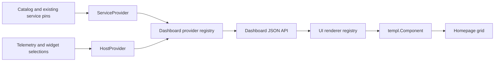

# Homepage widgets

Status: implementation contract. First delivery: pinned host metrics alongside existing service shortcuts.

The proposed [application plugin contract](2026-10-25-plugin-system-design.md) extends
rendering through a private UI/BFF runtime. It preserves this specification's
data-only dashboard API and existing service/host selection ownership.

## Boundaries

The homepage renders dashboard items, not a service list. A source provider owns selection and resolution of its data. A widget kind identifies a content contract. A presentation identifies a renderer. `card` is the default presentation, not the domain object or a required wrapper. Registered renderers return `templ.Component` and may render a chart, list, panel or other component directly.

The initial source providers are `service` and `host`; widget kinds are `service-links` and `host-metrics`. Host content contains current CPU, memory, freshness and observation time, with a link to the complete host page. The homepage has no selection control; a Show on home checkbox on the host page saves automatically. This delivery adds no manual HTML, remote component execution, layout editor or additional telemetry collection.

## Ownership and persistence

- `internal/application/dashboard` owns provider composition, stable item identity, partial source errors and desired selection commands. It imports no templ, HTTP or SQLite packages.
- Built-in providers resolve existing catalog and telemetry data. They do not discover resources or collect metrics.
- Service selection remains owned by the catalog, preserving grouped-service pin, hide, missing and purge behavior. The service provider adapts that existing contract; there is no second copy of service pin state.
- `dashboard_selections` persists source kind and source ID for sources without existing selection storage. The host provider uses it. Its composite key prevents duplicates. No foreign key to expiring telemetry: selection survives missing hosts and reappearance with the same identity.
- The UI registry maps widget kind plus presentation to a renderer. API content is data, never trusted markup. Unknown renderers display an unavailable item instead of breaking the homepage.
- Existing service cards retain appearance and search. The grid itself receives arbitrary components and never wraps every item in Card.

## Contracts

`GET /api/v1/dashboard` returns ordered items with `id`, `kind`, `presentation`, `sourceKind`, `sourceId`, `title`, `data`, and optional `error`; source failures are reported separately. Providers are ordered at registration; items within each source keep stable ordering.

`PUT /api/v1/dashboard/widgets/{sourceKind}/{sourceId}` accepts `{ "enabled": true|false }`. It sets desired state, never toggles. Repeated requests are idempotent. Unsupported sources return 400, missing hosts return 404 on add, unavailable storage returns 503. Removal remains possible after the underlying host disappears. A maximum of 128 persisted selections bounds homepage work.

The BFF exposes `POST /hosts/{hostID}/selection`, with explicit desired state and a validated 1h/24h return range. A checked `enabled=true` field selects the host; an unchecked field with the `selection_form=host` marker removes it. Native requests use PRG. HTMX replaces the selection control and displays mutation errors inline. Selection is shared by the gateway, as existing service pins are.

The home uses one SSE stream for the whole dashboard, with one bounded upstream snapshot every five seconds. Unchanged snapshots produce keepalives. Transport failure preserves the last rendered widgets and shows reconnect status. Host widgets have stable DOM IDs; live updates replace content without replacing selection controls or the grid. No stream or poll per card. Service search remains independent of metrics refresh.

## Surface brief

Primary task: open a pinned service or scan selected host CPU/memory from the home.
Existing identity: Balemoh shell, theme, service grid and Goshtoso typography.
Density: compact. One host widget groups both metrics, status and detail navigation.
Navigation: native detail links and HTMX pin controls; SSE updates values.
Presentation: reuse Goshtoso Card, Badge, Avatar, Button and Link. App-owned semantic metric content occupies public Card slots. Future renderers may omit Card entirely.
States: reporting, partial, stale, no telemetry, source unavailable and removed host. Missing numbers render Unavailable, never zero.

## Invariants and acceptance

1. Existing pinned services appear once and retain catalog lifecycle semantics.
2. One source identity yields at most one selected widget. Retrying add/remove does not duplicate or invert selection.
3. Node, Kubernetes cluster and Docker host identities can all be selected independently.
4. Pruning telemetry does not prune widget configuration; missing hosts show an unavailable widget that can still be removed.
5. A failing provider does not hide successful providers; transport failure cannot make old values look newly observed.
6. Rendering an additional registered kind or non-card presentation requires no change to the grid.
7. The API persists data and references only; no Go component, HTML or executable JavaScript is serialized.
8. One page has at most one dashboard SSE connection. Navigation tears it down.
9. Pin controls retain focus, report failures, and preserve host/range context.

| State | Action | Response | Durable effect |
|---|---|---|---|
| Existing host, unselected | Add | 200 or native 303 | One selection |
| Existing host, selected | Repeat add | 200 or native 303 | Still one selection |
| Missing host, unselected | Add | 404 with recovery | None |
| Selected host, including missing | Remove or repeat remove | 200 or native 303 | No selection |
| Malformed desired state | Submit | 400 inline error | None |
| Backend unavailable | Add/remove | 503 inline retry | No assumed success |
| Unknown source | API mutation | 400 | None |
| Source temporarily unavailable | Dashboard refresh | Partial result and warning | Configuration unchanged |

Validation covers SQLite restart/pruning/idempotency, provider isolation and extension, OpenAPI/client consistency, mixed rendering, unknown kind fallback, host pin routes and stream cancellation/recovery. Browser acceptance covers host add/remove, homepage persistence, live metrics, repeated actions, failure feedback, keyboard focus, narrow/wide layout and existing service search.

## Rollout

Migration 9 is additive. Deploy API before the new UI. Existing UI and API service endpoints remain valid. Rollback to the previous UI leaves selections intact; do not run the down migration unless intentionally discarding host selections. Homelab rollout authorized on 2026-10-14 after local review. Apply migration 9 through the API rollout before updating the UI.

## Initial implementation evidence, 2026-10-14

The checkbox revision below supersedes the original add/remove-button interaction.

- Migration, provider dispatch/isolation, renderer extension, idempotent desired state, selection limits and restart/pruning behavior have automated coverage. Root tests and vet passed; SQLite/HTTP/dashboard race tests passed. UI tests and vet passed; BFF/view race tests passed. Generated client compiles.
- Local browser acceptance used an isolated SQLite backup and synthetic data on API 28089/UI 28090. Added a Kubernetes host from its detail page, opened home, reloaded, removed it, and repeated add. Existing service shortcut and keyboard service search remained usable.
- Ingesting CPU 63.8% and memory 75.0% replaced 42.5%/50.0% through the dashboard stream without navigation. Server logs showed one active stream and zero after navigation cleanup.
- Stopping the local API produced an inline selection error, preserved the 24h URL and focus, and left retry enabled. Restarting the API and retrying succeeded. Removing the last widget showed the empty state; successful home removal focused live status.
- Home inspected at 390 and 1440 px in Goshtoso and Minimal, light and dark. No horizontal page overflow at 390 px; the no-telemetry card wraps missing values and its actions remain reachable. Host detail selection was exercised at 390 px and normal desktop width. Full alternate-theme detail/accessibility matrix remains unverified; the existing Minimal info badge contrast concern is recorded in the integration journal.
- Service search is initialized from the page snapshot. Changes to the service catalog in another tab require a page reload to rebuild search results; host metrics updates do not reset an active search.
- Initial acceptance ran locally on `feat/home-widgets`. Homelab rollout is tracked separately after user approval.

## Checkbox revision, 2026-10-14

Per user review, remove the home-card removal button and replace host-page add/remove buttons with a Goshtoso Checkbox labelled Show on home. Change submits through HTMX, disables the checkbox while saving, then restores focus. No-JavaScript browsers use a Save fallback. HTTP failures restore confirmed state; transport failures restore the previous checkbox state and show retry feedback.

Missing selected hosts still link to their host settings page. That page shows the checked option and an unavailable notice without opening a telemetry stream, so the user can remove an expired host selection.

Browser verification: uncheck on host detail removes its home widget; checking again persists after reload. Home cards expose View host; the refresh revision below adds a read-only action. Updated BFF/view tests cover unchecked submission, absence of home selection controls, and removal access for missing hosts.

## Per-widget refresh, 2026-10-14

Host cards expose Refresh beside View host. `GET /dashboard/widgets/{sourceKind}/{sourceID}` reads the latest dashboard snapshot and renders only the selected item through its registered renderer. It does not trigger agent collection, change selection, reload the page, or create another SSE connection. Native requests return to home.

The icon button has a Refresh tooltip and disables while pending. Success updates the widget and announces Updated. Source or transport failures retain the current card and show inline retry feedback. A widget removed elsewhere returns a reload-home message. Tests cover isolated rendering, provider/transport failure, unselected widgets and native navigation.

Successful manual refreshes animate only the updated widget with a 220 ms fade and 2 px rise. SSE and failed refreshes do not animate. Reduced-motion preferences disable the effect.

## Masonry layout, 2026-10-14

The homepage keeps equal-width responsive columns and each widget's natural height. A small dashboard runtime measures generic widget wrappers into CSS Grid row spans, with the existing 16 px gutter. Sparse placement preserves DOM order without rearranging widgets or depending on a particular renderer. The ordinary grid remains available without JavaScript or ResizeObserver.

ResizeObserver handles content and width changes. HTMX swaps reconcile measurements and attach or detach observers as widgets enter or leave the dashboard. Updates with unchanged dimensions retain their positions. Existing refresh animation and reduced-motion handling remain unchanged.

Local browser checks covered two-column packing, manual refresh with retained focus, widget removal and return through SSE, and 390/1440 px layouts without horizontal overflow. BFF and view tests passed. Homelab rollout authorized for direct browser acceptance on 2026-10-14.

## Source sections, 2026-10-14

Selected hosts always appear first, under Hosts. Services follow under Services. Other source kinds remain visible under Widgets, without requiring a card renderer. Each nonempty section owns its masonry grid. Source order within each section remains stable; initial rendering and SSE snapshots use the same grouping. Empty sections are omitted.
