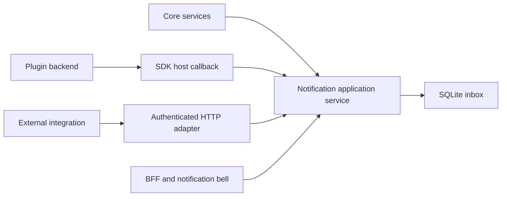

# Unified notifications

Status: N1–N5 implemented, independently reviewed and deployed to the homelab.
Verification evidence is recorded in N5 of the implementation plan.

Milestone: trusted, single-instance pre-v0.1.0 Balemoh. A shared inbox accepts
notifications from core services, installed plugins and authenticated external
integrations. Notifications remain readable when their producer is unavailable.

Related contracts: [application plugins](2026-10-25-plugin-system-design.md),
[foundation](2026-08-15-balemoh-foundation-design.md), and
[implementation plan](../plans/2026-10-25-notifications-implementation.md).

## Ownership

Notifications belong to the core application, not to Alertmanager or the BFF.
An alert is an observed condition. A notification is a message delivered to
the inbox. Reading a notification does not acknowledge, silence or resolve its
source alert. No producer may change another producer's notifications.

The last connection represents an API client call, never a BFF import of core
internals. Application ports contain domain types, not generated HTTP, gRPC,
templ or SQLite types. External producers can include jobs, agents and other
services without installing a UI plugin.

## Message and delivery contract

| Field | Contract |
| --- | --- |
| `id` | Host-issued immutable UUID, returned after durable acceptance |
| `source` | Adapter-assigned kind and stable ID; optional plugin connection ID |
| `eventId` | Producer-issued stable event identity, at most 128 bytes |
| `severity` | `info`, `success`, `warning` or `critical`; independent of alert severity |
| `title` | Required plain text, at most 200 characters |
| `body` | Optional plain text, at most 4,000 characters; never raw HTML |
| `occurredAt` | Source timestamp; cannot exceed host time by more than five minutes |
| `receivedAt` | Host acceptance time; ordering uses a host-issued sequence |
| `destination` | Optional typed internal reference or validated HTTPS URL |
| `readAt` | Nullable host timestamp for the shared inbox |

`Publish(ctx, source, message)` returns a receipt containing `id` and whether
the event was newly accepted. The authenticated adapter supplies `source`.
The payload cannot impersonate core services, plugins or another integration.

Uniqueness is `(source kind, source ID, connection ID, eventId)`. Replaying an
identical message returns the original receipt and preserves its read state.
Reusing that identity with different content returns a conflict. Producers
persist/reuse their event IDs when retrying; the core does not promise to
deduplicate different IDs describing the same occurrence.

All four identity columns are `NOT NULL`. Normalize absent connection IDs to
the empty string for core/external sources; plugin sources require a real
connection UUID. A unique index spans those four canonical columns. Do not
persist SQL NULL in the uniqueness key. Test replay and conflict both with
and without a connection ID.

After authentication and envelope validation, resolve an existing event before
applying new-message capacity limits. Identical replay still succeeds at
capacity and never increments unread count; conflicting replay returns 409.
For new events, uniqueness and capacity checks share one transaction, so
concurrent publishers cannot exceed the limit or produce duplicate rows.

A successful receipt means SQLite committed the message. Timeouts are ambiguous
and require retry with the same identity. Producers control their own durable
outbox if they require delivery across their own restart. Publishing does not
wait for any browser, remote destination or notification channel.

Notifications initially share one instance-wide read state, matching Balemoh's
current operator model. Per-user recipients/read state require a later identity
contract; this milestone must not imply private user inboxes. Email, push, SMS,
delivery rules and user subscriptions are outside this initial delivery.

## API and access

The private instance API exposes:

| Method and route | Behavior |
| --- | --- |
| `GET /api/v1/notifications` | Cursor page, optional unread filter, exact unread total |
| `GET /api/v1/notifications/{id}` | Historical message and typed destination, with operator authority |
| `POST /api/v1/notifications` | Authenticated external publication; source bound to credential |
| `PUT /api/v1/notifications/{id}/read` | Idempotently mark one notification read |

Ingress credentials are separately scoped notification-publisher credentials.
Existing federation or plugin-service credentials do not implicitly grant
publication. Credentials must not reach the browser or plugin processes.
Inbox access follows the instance's existing trusted operator boundary, not
publisher credentials. Mutating BFF routes require same-origin protection.

| Operation | Required authority |
| --- | --- |
| List/count/read message text | Trusted operator through the private instance API/BFF |
| Mark read | Same operator boundary, with same-origin protection in the BFF |
| External Publish | Bearer mapped to exactly one external source; no operator authority |
| Core Publish | In-process trusted application port |
| Plugin Publish | Backend-only scoped callback with an active connection grant |

Do not publish an inbox/read route with the external ingress. No new public
route is implied. If externally exposing Publish later, expose only its
credential-protected adapter. Publisher credentials are not operator credentials.
The ingress and operator adapters must reject credentials of the other class,
including GET/PUT requests bearing a publisher credential and external POSTs
bearing an operator/BFF credential. Network access alone does not convert a
publisher credential into an operator credential.

An unknown notification returns 404. Invalid content returns 400, missing or
invalid publication credentials 401, source/grant violations 403, identity
conflicts 409 and capacity/concurrency limits 429. Unavailable storage returns 503.
Responses contain safe messages and request IDs, never raw database errors,
producer credentials or arbitrary upstream response bodies.

Listing uses descending host sequence with an opaque `before` cursor and a
maximum page size of 50. Page rows and unread count come from one database
snapshot. Concurrent insertions cannot reorder older cursor pages. There is
no mark-all action in this milestone, avoiding ambiguous scope during arrival.

## Plugin SDK and runtime

The optional manifest capability is `notifications.publish/v1`. Deployment
configuration grants it per connection through a separate capability grant,
not through a query ID. Declaration alone grants nothing. Old plugins need
no capability or source changes. Hosts lacking the optional capability disable
publication explicitly; a required unsupported capability rejects installation.
A manifest declaring publication must supply a backend executable on every
target. The supervisor starts a backend for publication even if its query list
is empty. UI-only plugins cannot declare this backend capability.

The SDK exposes `notifications.Message`, `notifications.Receipt` and
`notifications.Publisher`. A granted backend receives a scoped Publisher when
configured. UI handlers receive no publishing service. Rendering a page or
widget must never generate notifications as a side effect.

The backend calls a host gRPC callback carried by the go-plugin broker. The
host binds plugin and connection identity, validates the grant and envelope,
then calls the same core Publish port used by other adapters. No private HTTP
credential is passed to the child. Plugin targets use declared page IDs and
validated parameters. Persist their typed plugin/connection/page reference and
validated parameters, not just a resolved URL. A host-owned open-destination
route revalidates the current installation and declared page before redirecting.
Missing/uninstalled targets show an unavailable destination inside the core
inbox. This metadata check never invokes a child or fetches source observations.
Following a destination does not mutate read state.

External destinations require an absolute `https` URL with a nonempty valid
hostname and no userinfo or control characters. Reject protocol-relative URLs,
other schemes and malformed percent encoding. Core destinations come from
host-owned routes rather than producer HTML. Render external destinations as
explicit external links with `rel="noopener noreferrer"`; do not fetch them
server-side. Destination errors reject publication, not the entire inbox.

Callback lifetime follows the configured connection. Disable, replacement,
child exit and shutdown close its callback. Old sessions cannot publish after
revocation. In-flight accepted messages remain in the inbox. New RPCs/fields
must preserve old-plugin compatibility and include a transport-level test.

## Header and inbox

The bell opens a Goshtoso popover with recent notifications, a text-labelled
severity badge, source, age, unread state and an `All notifications` link.
The full `/notifications` page owns pagination and explicit read actions.
Opening the popover does not mark everything read. Following a destination and
marking a notification read are separate actions; a failed write cannot suggest
that reading succeeded. A missing destination leaves a readable message.

The header renders immediately. A separately targeted BFF fragment loads the
unread indicator asynchronously; the tray loads on first open. Initial loading,
empty and unavailable are distinct states. Failure never becomes a fabricated
zero. Refresh permits one in-flight request per document. While visible, refresh at
15-second intervals; pause in hidden documents and refresh once when visible
again. Failures back off to 30, then 60 seconds, capped at 60 until recovery.
Successful responses reset the interval. A visibility change must not start a
second request while one is pending.
It must not invoke plugin children or fetch Alertmanager observations.

Only the badge, changed rows and explicit dependent regions update. Existing
header controls, open popover, scroll, keyboard focus, drafts and SSE stay
mounted. Use Escape/focus restoration from the supported popover runtime.
The bell has an accessible name reflecting unread count or unavailability;
count display caps visually at `99+` while accessible text retains the total.

## Clearing the inbox

The operator may permanently clear all stored notifications, including read
messages and messages outside the current page/filter. `DELETE /api/v1/notifications`
requires the operator credential. Producers cannot clear the inbox. SQLite executes
one atomic DELETE without resetting its sequence. Messages committed after that
statement remain visible; an empty inbox clears successfully too.

Clearing removes deduplication identities with their messages and frees inbox
capacity. A later publisher retry of a cleared event is a new acceptance. Clearing
never acknowledges, resolves or silences an alert at its source. No automatic
clear retry occurs after an ambiguous timeout. The UI asks the operator to refresh
before a new clear attempt.

The full inbox offers Clear all through a Goshtoso confirmation dialog with an
explicit required checkbox. A native GET confirmation and POST/Redirect/Get path
work without JavaScript. Same-origin protection wraps the BFF mutation. Successful
partial writes update the inbox, bell and count without replacing the shell;
failures remain in the confirmation and do not suggest zero messages.

| State/request | Allowed | Response/effect | Preserved context and focus |
|---|---|---|---|
| Inbox, open or cancel confirmation | yes | no write | existing inbox; trigger focus on close |
| Missing confirmation, POST | no | 400; zero clears | confirmation error and retry control |
| Cross-origin POST | no | 403; zero clears | stored messages unchanged |
| Publisher/anonymous DELETE | no | 401; zero clears | stored messages unchanged |
| Confirmed clear, read/unread and multiple pages | yes | 204 API; empty stored inbox | shell retained; confirmation closes to trigger |
| Already empty, repeated clear | yes | 204; remains empty | no duplicate request while pending |
| Publisher commits after clear | yes | new message retained | refreshed list/count show actual new state |
| Storage/transport failure | no confirmed effect | 503/error feedback; no automatic retry | confirmation remains open; no false zero |
| Native confirmed POST | yes | 303 to inbox | stable GET after refresh |

Queued clear submissions coalesce with HTMX `queue last`; a refresh holding the
shared notification lock must not admit multiple DELETEs from repeated clicks.
The manual real-browser harness in
`ui/internal/bff/testdata/notification-clear-queue.py` holds that refresh and
records the number of clears. It injects one fixture message after the first
clear and refuses a second destructive request. Run it only with disposable
loopback API/UI fixtures. Assert three queued submissions yield exactly one
clear and the API retains the post-clear message. HTTP/storage tests cover
mixed read states, more than one page, empty repetition, denied credentials,
confirmation validation and native PRG; rendering tests retain coalescing and
native fallback attributes.

## Limits, retention and recovery

The initial author envelope limit is 16 KiB of canonical Go `encoding/json`
message bytes, excluding host-assigned source identity. It uses camelCase message
fields, a UTC timestamp, and omits empty body and absent/zero destination. SDK and
core enforce the same representation, including JSON escaping overhead. HTTP raw
request bodies and callback protobuf requests each have a separate 16 KiB bound.
Oversized input is a permanent validation failure, never retryable unavailability. Publication permits at most four
concurrent calls per producer and uses a five-second deadline. There is no
time-window rate guarantee in this trusted initial milestone. Concurrency,
envelope and inbox bounds are enforced before acknowledgement. Busy concurrency
returns 429 with `Retry-After: 1`; inbox capacity returns 429 with a distinct
non-retryable capacity reason, without implying that waiting frees storage. The initial
inbox holds at most 10,000 rows; capacity returns 429 rather than silently
discarding unread messages. Automatic retention expires read and unread messages as described below.
HTTP/callback bounds apply independently of browser traffic.

SQLite migration is additive. Backup/restore includes the inbox and read state.
A producer outage does not hide historical messages. A plugin upgrade must not
delete messages, reset read state or reassign their source identity. Uninstall
leaves source attribution and text; a missing plugin destination reports that
its target is unavailable rather than routing to an unrelated page.

## First producer and acceptance

Alertmanager is the first plugin producer, not the owner of the service. Its
initial successful observation establishes a silent baseline. New active
critical/warning occurrences get a best-effort delivery attempt keyed by connection,
fingerprint and firing start time. Ordinary polling and UI renders do not
re-notify. Suppressed alerts, normal Watchdog/InfoInhibitor observations and
restarts do not generate an unsolicited backlog. Recovery messages are outside
the first producer milestone.

The first producer uses an in-memory baseline per backend session. Every new
session establishes a silent baseline again. This cannot report transitions
that occurred while the backend was stopped, or guarantee delivery of an
unpublished transition across a child crash. Publish work runs on a bounded
64-entry FIFO queue outside collection and UI paths. For each successful complete
observation, detect previously unseen active occurrence keys and mark them seen
before attempting queue admission. An admitted message is handled by the worker;
a full queue drops that occurrence once. Later polls do not retry admission for
the dropped occurrence while it stays active. A transition is eligible again
only after a complete observation removes it from the active seen set and a
later complete observation presents it again. Identical repeated event IDs are
still deduplicated by the core. Partial/failed observations cannot remove seen
entries or trigger new-event publication. On a timeout, retry with
the same identity and bounded exponential backoff while that session is alive.
A full queue records one structured capacity warning for the dropped occurrence
and does not block collection. Core idempotency protects already accepted events.

Do not claim a durable plugin outbox or complete incident history. A later
durable producer milestone must first add the namespaced state/migration/backup
contract required by the plugin spec, including atomic transition/outbox
persistence and publish acknowledgement ordering. This is not a prerequisite
for the initial best-effort producer.

Acceptance also requires one core fixture producer and one external producer,
without Alertmanager imports. Prove duplicate retry, conflicting replay,
read-state persistence, concurrent unread totals, rejected grants, revoked
callbacks, plugin restart, source outage, malicious destinations and isolated
UI refresh. Hold Publish and callback responses pending in isolated tests and
prove collection still completes; remove/stop all plugins while refreshing the
inbox and prove notifications remain readable and acknowledgeable.
Production verification must not insert synthetic notifications or
modify real pins/options. Use an isolated database and source fixtures for writes.

## Operational configuration

The API reads its private operator token from
`BALEMOH_NOTIFICATION_OPERATOR_TOKEN_FILE`. The BFF reads the same token from
`BALEMOH_UI_NOTIFICATION_OPERATOR_TOKEN_FILE` and attaches it only to notification
API requests. Missing UI credentials leave the shell available and notification
fragments unavailable. Token files require at least 32 bytes.

External ingress is disabled unless `BALEMOH_NOTIFICATION_PUBLISHERS_FILE` points
to a JSON object mapping external source IDs to private token-file paths. Tokens
must be distinct from each other and from the operator token. Neither credential
class is sent to plugin children or included in browser HTML.

Plugin API deployment connections use `capabilityGrants` separately from query
`grants`. For example, `"capabilityGrants": ["notifications.publish/v1"]` authorizes
only that backend connection. The BFF requires no publication grant.

## Jira-inspired notification tray and retention

The tray uses Goshtoso Popover, Toggle, Dropdown, Button, Link, Icon and Badge.
Its compact rows show a source icon, title/destination, receipt age, short preview,
severity and unread dot. Date groups use receipt dates and explicitly label UTC,
matching the existing UTC observation display. Today/Yesterday labels are based
on UTC calendar boundaries. The full inbox retains complete message bodies.
No Direct/Following tabs or actor identities are invented for producers that do
not expose those concepts.

Header, filter and action menu stay mounted while only the scrollable list
morphs. The unread filter is retained while closing/reopening the tray. The
notification count remains the global retained unread count. Full-inbox links
carry the chosen unread filter. The action menu offers Mark all as read and
Refresh. Clear all remains a separate full-inbox action with confirmation.
Tray and full-inbox controls have different stable IDs even for the same message.

`PUT /api/v1/notifications/read` requires operator authorization. One atomic
UPDATE marks all retained unread rows read across sources/pages, without deleting
content or rewriting existing read timestamps. Publications committed after that
UPDATE remain unread. BFF POST is protected against cross-origin requests and
uses `queue last` for coalescing. Pending actions disable their trigger. Native
full-inbox forms retain POST/Redirect/Get. Ambiguous failures are announced without
automatically retrying a mutation.

`BALEMOH_NOTIFICATION_RETENTION_DAYS` is a typed integer, default 30 for unset or
empty values, range 1 through 3650. Each day is 24h from `receivedAt`; expiration
uses UTC epoch-second precision with the cutoff rounded down to the second.
Read and unread messages expire alike. List/count/get/read-state operations hide
expired messages immediately. A core-owned worker physically deletes them at
startup and hourly, with a 5s deadline per sweep, cancellation and shutdown join.
HTTP and plugin publication share the same configured service. Publication
atomically reclaims expired identities or full inbox capacity before acceptance.
No migration or plugin SDK contract change is required.

Physical expiry deletes deduplication identities too. A later producer retry is a
new acceptance with a new receipt timestamp. The 10,000-row cap still rejects new
messages if retained rows fill capacity. Increasing retention cannot restore
rows already pruned; restoring a database requires separate recovery review.
The UI displays the server's actual retention period rather than assuming 30 days.

Surface brief: operator scanning incoming events; compact operations list inside
the existing shell; title and unread state first, source/time second, preview and
severity third. Existing Balemoh tokens and typography remain authoritative.
No new animation, font, synthetic avatars or color palette is introduced.

| State/action | Expected effect | Preserved state and focus |
|---|---|---|
| Toggle unread filter | GET-only filtered tray; global count retained | open tray, checkbox focus, list scroll and shell/SSE |
| No unread messages | explicit No unread notifications | filter remains on; no false storage failure |
| Open action menu / cancel | zero writes | parent tray stays open; keyboard focus returns |
| Mark all as read | one atomic update across pages | messages retained; later publication remains unread |
| Repeated submits behind refresh | one coalesced mutation | no repeated mark of later publications |
| Read-state storage/transport failure | visible unconfirmed state; no automatic retry | tray/filter remain mounted; no false success |
| Expired unread/read rows | excluded from list/count/get, then pruned | retained messages and read timestamps unchanged |
| Retention boundary/configuration | cutoff included; older rows expired; invalid config rejected | configured period reported by API/UI |
| Clear all | separate confirmed permanent DELETE | no alert acknowledgement/silence at producer |
