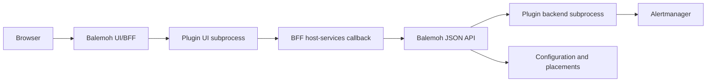
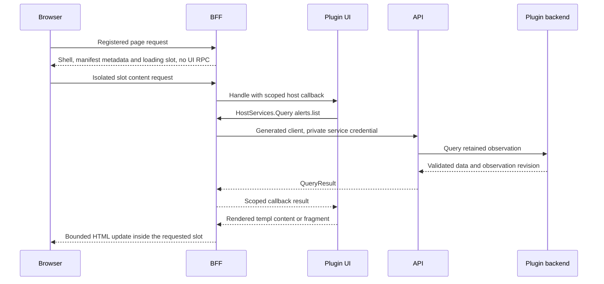
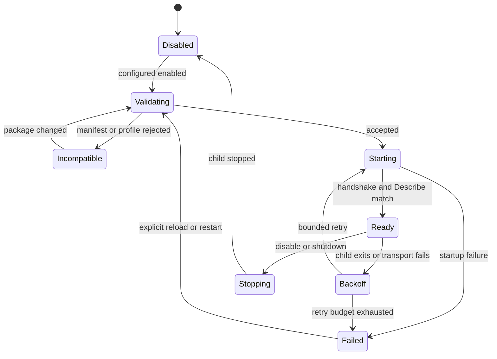

# Application plugins

Status: implementation contract. P1 through P7 implemented locally; P8 acceptance and authorized homelab validation in progress. See the implementation plan and acceptance ledger for evidence.

Milestone: pre-v0.1.0 exploration. Deliver independently compiled, trusted application plugins with sidebar navigation, pages and selectable home widgets. Alertmanager is the first full-stack consumer. This document does not authorize release or deployment.

Execution sequence: [Application plugins implementation plan](../plans/2026-10-25-plugin-system-implementation.md).

## Related contracts

- [Foundation and dependency direction](2026-08-15-balemoh-foundation-design.md).
- [Homepage widgets](2026-10-14-home-widgets-design.md).
- [Host telemetry](2026-10-07-host-telemetry-design.md).
- [Roadmap](../../roadmap.md).
- References: [Grafana app plugins](https://grafana.com/developers/plugin-tools/tutorials/build-an-app-plugin), [Grafana backend lifecycle](https://grafana.com/developers/plugin-tools/key-concepts/plugin-lifecycle), [Backstage extensions](https://backstage.io/docs/frontend-system/architecture/extensions/), [Homarr custom widgets](https://homarr.dev/docs/management/custom-widgets/) and [Home Assistant custom panels](https://contributors.home-assistant.io/frontend/custom-ui/panel/).
- Transport: [HashiCorp go-plugin](https://github.com/hashicorp/go-plugin).

## 1. Scope and boundaries

A plugin is an installed application package. It can contribute several pages, navigation entries and widget definitions. Authors implement UI in Go/templ with Goshtoso, with optional plugin-owned JavaScript and styles. Application behavior does not have to fit a central layout language.

Manifest declares contributions and compatibility. Code implements rendering and behavior. Balemoh controls placement, routing, shell, shared configuration, data transport and process lifecycle.

First delivery includes local executable plugins using go-plugin with gRPC, public SDK and scaffold, explicit installation, source connections, independent widget placements, page/fragment rendering, read queries, basic failures and shared observations. A second small fixture plugin must prove that extension does not depend on Alertmanager-specific core code.

Not included: untrusted executable/browser code, marketplace, automatic downloads, public installation endpoint, hot replacement, arbitrary DOM injection, multi-replica backend ownership, third-party mutations such as creating silences, or complete alert history. Contextual extension points reserved below are not initial acceptance requirements.

## 2. Existing architecture and extension

Baseline inspected at main commit `35f2560a4e6e26247a9c9dd18b6a48aba3215a4b`:

| Owner | Current behavior | Extension |
| --- | --- | --- |
| `internal/application/dashboard` | Composes providers without HTTP or templ | Generic plugin provider returns references and observation revisions |
| `ui/internal/bff/dashboard.go` | Compiled renderer map | One generic renderer dispatches to plugin UI runtime |
| `ui/internal/view/widgets.templ` | Generic wrappers contain arbitrary components | Preserve host wrappers and layout geometry |
| `ui/internal/view/shell.go` | Fixed navigation | Merge validated navigation contributions |
| `ui/internal/bff/server.go` | Explicit routes | Add one namespaced plugin dispatcher |
| `ui/internal/view/pages.templ` | Concrete page-model switch | Add plugin page-content slot |
| Migration 9 | Source-kind/source-ID selections | Keep rows; add independent plugin placements |
| `ui/internal/bff/dashboard_events.go` | Polls API every five seconds per browser | Reuse stream; external collection is independent |

Service pins, host selections and discovery retain their existing owners. Displaying data does not make a plugin a discovery source.

Dashboard JSON stays data-only. HTML is permitted only on the private UI-runtime channel and BFF HTML responses. Never put executable markup in `DashboardWidget.data`.

## 3. Topology and ownership



Each host communicates with its local child through go-plugin/gRPC. BFF calls API through the generated OpenAPI client. go-plugin is not the cross-pod transport.

| Owner | Responsibility |
| --- | --- |
| API application | Connection records, placement configuration/selection, query dispatch and data-only dashboard references |
| API adapters | Persistence, service-credential verification and backend process transport |
| BFF | Browser validation, shell/navigation, dispatch, HTML composition and UI runtime |
| Plugin UI | Handlers, view models, templ rendering and optional frontend behavior |
| Plugin backend | Source-specific validation, collection, normalization, queries and optional state |
| SDK | Wire adapters, author interfaces, scoped callbacks, URL/DOM helpers and dev harness |

Package can contain UI only or UI plus backend. Alertmanager contains both executables. One child per plugin capability serves all its configured connections; no process per request/widget. First deployment supports one API backend owner and one BFF. Distributed collection and writer election are unsupported.

Core application packages depend on inward-facing interfaces. Only adapters import go-plugin, generated RPC types or persistence implementations. Authors import public SDK/UI libraries, never Balemoh `internal` packages.

## 4. Identity and persistence

| Identity | Meaning |
| --- | --- |
| `pluginId` | Installed application, such as `araihu.alertmanager` |
| `pluginVersion` | Package SemVer release |
| `connectionId` | Host-issued UUID for one configured source |
| `contributionId` | Stable local page/widget ID, such as `current` or `summary` |
| `placementId` | Host-issued UUID for a configured widget; several may share one connection/definition |
| `revision` | Monotonic configuration revision used for optimistic concurrency |

Plugin IDs use lowercase dotted labels, 3 to 128 characters. Contribution IDs use lowercase letters, digits and hyphens, 1 to 64 characters. IDs cannot contain path separators or encoded separators. Contribution identity is scoped by plugin and type. Host verifies uniqueness before launching children.

Proposed records require additive migrations during implementation:

| Record | Fields and semantics |
| --- | --- |
| Connection | UUID, plugin ID, name, validated public configuration JSON, secret references, enabled, revision, timestamps |
| Placement | UUID, plugin ID, connection UUID, widget definition ID, validated options JSON, enabled, revision, timestamps |
| Installation | Trusted deployment configuration pointing to immutable local package and expected digest; not browser-editable |

Existing limit of 128 persisted non-service dashboard selections includes hosts and plugin placements. Service pin semantics are unchanged. Disabled placements retain options. Disabling a connection retains placements. Deleting a connection with placements returns conflict. Removing installation files never cascade-deletes records or plugin state.

Writes are atomic. Updating/deleting placement requires `If-Match` with current revision and returns a new ETag when updated. Create uses caller-generated UUID and `PUT`: identical repeated create succeeds; different body at that UUID conflicts. Observations are not widget configuration.

Create comparison uses validated JSON values rather than byte/key order. Check replay identity before applying the selection limit. A repeated update whose ETag is stale returns 412; BFF reloads confirmed state and can report success only if current desired values match the submitted values.

## 5. Package and manifest

Package contains UTF-8 `plugin.json`, target-specific executables, local JSON Schemas and optional assets. A package may contain multiple targets. Installation pins complete package digest. Both hosts use the same manifest revision; target map selects their platform binaries.

Manifest version 1 uses closed objects: unknown fields are errors. Referenced schemas use JSON Schema draft 2020-12 and local references only. Paths must remain inside package root and cannot be absolute, traverse parents or escape through symlinks. Validate before child execution.

| Field | Contract |
| --- | --- |
| `manifestVersion` | Required integer `1` |
| `id`, `version`, `name` | Required plugin identity, SemVer and display name |
| `protocol` | Required exact identifier `balemoh.plugins/v1alpha1` |
| `uiProfile` | Required exact supported visual profile |
| `targets` | Required platform map to UI and optional backend executable paths |
| `connectionSchema` | Required local schema for non-secret configuration |
| `secrets` | Array of declared keys and required flags, never values/host paths |
| `queries` | Read-operation IDs, local input/output schemas and capability |
| `pages` | IDs, required title, optional description, relative patterns, allowed methods and required capabilities |
| `navigation` | Page links or groups of children |
| `widgets` | IDs, titles, option schemas and required capabilities |
| `assets` | IDs, files, media types and module/style kind |
| `capabilities` | Required/optional host facilities |

All fields in the table are required, with empty arrays where applicable. At least one page or widget is required. Backend entrypoint is required when queries are declared. Query IDs use dotted lowercase labels, such as `alerts.list`, 1 to 64 characters; they are operation names, not contribution IDs. Unknown required capability rejects installation; unknown optional capability is reported unavailable and a contribution whose requirements include it is omitted.

Pages, navigation and widgets require declarations of `page.content/v1`, `sidebar.navigation/v1` and `home.widget/v1` respectively. These extension points may be required or optional, but cannot be implicit. Host mounts only compatible installations and contributions whose declared requirements were negotiated successfully.

Initial Alertmanager manifest:

```json
{
  "manifestVersion": 1,
  "id": "araihu.alertmanager",
  "version": "0.0.1",
  "name": "Alertmanager",
  "protocol": "balemoh.plugins/v1alpha1",
  "uiProfile": "balemoh.goshtoso/v1alpha1",
  "targets": {
    "linux/amd64": {"ui": "bin/linux_amd64/ui", "backend": "bin/linux_amd64/backend"},
    "linux/arm64": {"ui": "bin/linux_arm64/ui", "backend": "bin/linux_arm64/backend"}
  },
  "connectionSchema": "schemas/connection.json",
  "secrets": [{"id": "bearer-token", "required": false}],
  "queries": [
    {"id": "alerts.list", "inputSchema": "schemas/list-input.json", "outputSchema": "schemas/list-output.json", "capability": "data.query/v1"},
    {"id": "alerts.get", "inputSchema": "schemas/get-input.json", "outputSchema": "schemas/get-output.json", "capability": "data.query/v1"}
  ],
  "pages": [
    {"id": "current", "title": "Current alerts", "path": "/current", "methods": ["GET"], "capabilities": ["data.query/v1"]},
    {"id": "detail", "title": "Alert details", "path": "/current/{fingerprint}", "methods": ["GET"], "capabilities": ["data.query/v1"]}
  ],
  "navigation": [{"id": "alerts", "title": "Alerts", "page": "current"}],
  "widgets": [
    {"id": "summary", "title": "Alert summary", "optionsSchema": "schemas/widget-options.json", "capabilities": ["data.query/v1"]},
    {"id": "active-list", "title": "Current alerts", "optionsSchema": "schemas/widget-options.json", "capabilities": ["data.query/v1"]}
  ],
  "assets": [],
  "capabilities": {"required": ["page.content/v1", "home.widget/v1", "sidebar.navigation/v1", "data.query/v1"], "optional": []}
}
```

No history or source mutation is advertised initially. A later package can add history page and navigation child without changing host routes. Navigation items are either registered-page links or child groups, maximum depth two. Relative route patterns accept literals and named single-segment parameters. Reject ambiguous patterns, duplicate parameters and catch-all routes.

With multiple enabled connections, navigation groups contributions under each connection's name. Every destination names a connection; deep links never select an arbitrary default. Package exports exclude local URLs, secret references and credentials.

## 6. Extension points

| Point | Initial support | Contract |
| --- | --- | --- |
| `sidebar.navigation/v1` | Yes | Ordered links/groups; host computes href and active state |
| `page.content/v1` | Yes | Content within host page wrapper, never global document/shell |
| `home.widget/v1` | Yes | Content within stable placement wrapper; host owns selection/options |
| `service.actions/v1` | Reserved | Future typed public service context |
| `host.detail.tabs/v1` | Reserved | Future stable host reference and visible public data |
| `page.header.actions/v1` | Reserved | Future host-controlled contextual actions |

Reserved points are not available capabilities. Initial ordering is built-ins, plugin ID, manifest declaration order and connection ID. Unlisted pages remain directly addressable. Installation never automatically pins widgets.

Plugin can use Card, Panel, list, chart or another composition inside a mount. A widget is not a mandatory card. Host owns wrapper identity, controls and measurements. Plugins cannot nominate arbitrary DOM selectors, replace shell or override another contribution. New host points require a host release; new pages/compositions using supported points do not.

## 7. Public SDK and wire contract

Module `github.com/araihu/balemoh/plugin-sdk` lives in `plugin-sdk/` with independent `go.mod`.

| Package | Responsibility |
| --- | --- |
| `manifest` | Author types and manifest validation |
| `ui`, `backend` | Author handler interfaces and request/result types |
| `host` | Invocation-scoped services for UI children |
| `render` | Bounded templ-to-HTML response helpers |
| `runtime` | go-plugin/gRPC client/server and broker callbacks |
| `protocol/v1alpha1` | Committed protobuf definitions and generated messages/stubs |
| `testing` | Fake services and conformance/dev fixtures |
| `cmd/balemoh-plugin` | Scaffold/dev/package CLI |

Normative author behavior, with concrete wire definitions committed during implementation:

```go
type UI interface {
    Handle(context.Context, UIRequest, HostServices) (UIResponse, error)
}

type Backend interface {
    Configure(context.Context, ConnectionConfig) (ConnectionStatus, error)
    Status(context.Context, string) (ConnectionStatus, error)
    Query(context.Context, QueryRequest) (QueryResult, error)
    CloseConnection(context.Context, string) error
}

type HostServices interface {
    Query(context.Context, string, json.RawMessage) (QueryResult, error)
    Placement(context.Context) (Placement, error)
}
```

These signatures describe SDK adapters, not passing Go interfaces over RPC. Values are serialized. templ renders inside UI child into a bounded buffer. No `templ.Component`, closure, DB handle or `http.ResponseWriter` crosses RPC.

`HostServices.Query` is bound to current plugin, connection, capability grants and originating request. Caller cannot supply a different plugin/connection or asserted viewer. Each invocation gets a scoped broker callback, cancellation and deadline. `Placement` is read-only and scoped to current placement. Host routes own writes.

| RPC service | Methods |
| --- | --- |
| Control, both children | `Describe`, `CheckHealth`, `Shutdown` |
| UI | `Handle` |
| Backend | `Configure`, `Status`, `Query`, `CloseConnection` |
| Host callback | `Query`, `Placement` |

Describe returns plugin ID/version, manifest digest, protocol and visual profile. Host reads/validates manifest before execution, negotiates gRPC and verifies Describe against installation. API/BFF manifest mismatch disables plugin integration, not core pages. Protocol, package SemVer and visual profile are separate compatibility checks.

### UI envelope

| UIRequest field | Meaning |
| --- | --- |
| `requestId` | Host correlation ID |
| `connectionId`, optional `placementId` | Resolved by host |
| `contributionType`, `contributionId` | Page/widget and registered ID |
| `method`, `pathParams`, `query`, `form`, `body` | Normalized bounded request values; allowed by registration |
| `mode`, `region` | Host-selected page/fragment/widget and optional registered local region |
| `locale`, `timezone`, `theme`, `colorScheme` | Display context, not identity claims |
| `viewer` | Optional verified identity; absent in initial shared mode |
| `urls`, `domNamespace` | Host routing context and stable ID namespace |

UIResponse fields are `kind` string, `status` integer, optional `title`/`description` strings, `html` bytes, `assetIds` string array and optional typed `redirect`. Kinds are `content`, `fragment`, `redirect` and `no-content`. Content serves page/widget requests; fragment serves local region requests; redirect uses 303 with no HTML; no-content uses 204. Content/fragment normally use 200 and may use a documented 4xx status for a rendered local error. Host verifies kind against request mode. Page content is main content, not a complete document.

Response cannot set arbitrary headers/cookies. Host derives content type, cache policy and permitted HTMX metadata from typed fields. Redirect resolves a registered route in the same plugin/connection; raw caller-supplied return URLs are rejected. External destinations are validated ordinary links. Invalid output becomes local `invalid_response` fallback.

SDK helpers resolve named page URLs/parameters/query, local fragment URLs, asset URLs and DOM IDs. They include deployment base path. DOM IDs include connection/placement when applicable. Authors can create arbitrary UI inside a contribution without registering every row/control centrally.

### Configuration and data

ConnectionConfig contains connection ID, revision, schema-validated public config and resolved declared secrets granted only to backend. Same revision is idempotent. Failed Configure retains previous valid collector/configuration without partial replacement. Secrets never appear in Describe, UI requests, query output or errors.

QueryRequest contains connection ID, operation ID and JSON input. QueryResult contains JSON data, state, observedAt, lastSuccessAt, observation revision and optional sanitized source error. States: fresh, partial, stale, unavailable. Unknown readings remain null. Source outage is independent of process health.

JSON encodes timestamps as UTC RFC3339, nullable until first successful collection. Configuration, placement and observation revisions are opaque decimal strings on the wire to avoid JavaScript integer truncation. JSON payloads are objects; input/output schemas define their fields. ConnectionStatus contains state, applied configuration revision, observation revision, observedAt, lastAttemptAt, lastSuccessAt and optional source error. `Status` reads metadata only and must not trigger collection. Observation revision changes when data or reported source state changes; observedAt changes only on successful collection.

The data API descriptor also reports host `ready`, nullable applied/observation
revisions until the backend confirms them, and `lastConfigureAttemptAt` plus an
optional sanitized `configurationError`. Configure rejection does not fabricate
source `lastAttemptAt`/`sourceError`; those fields preserve backend collection
metadata. Grants are published only after successful Configure. BFF resolves
current grants inside each isolated content request, so asynchronous startup
cannot freeze an initially empty grant set.

Queries are read-only. Inputs cannot specify arbitrary upstream URL/method/headers/credentials. Validate input before dispatch and output before publication using declared schemas. A POST query envelope does not permit source mutation. Future side effects require separate command and authorization contracts.

## 8. API and browser routes

All routes below are additions. Implementation must update OpenAPI and regenerate client before BFF consumes them. Existing routes remain unchanged.

| Data API route | Contract |
| --- | --- |
| `GET /api/v1/plugins` | `{plugins, problems}` with public descriptors, connection availability and sanitized installation problems |
| `POST /api/v1/plugins/{pluginId}/connections/{connectionId}/queries/{queryId}` | Validated `{ "input": ... }`, returns QueryResult |
| `GET /api/v1/plugin-widgets` | Configured placements and selection |
| `PUT /api/v1/plugin-widgets/{placementId}` | Idempotent create or revision-checked options/desired-state update |
| `DELETE /api/v1/plugin-widgets/{placementId}` | Revision-checked deletion of configuration, never source data |

Installation validation failures are local to the affected package/connection.
The API continues serving core routes and valid installations, publishes fixed
errors keyed by public installation ordinal and known plugin/connection IDs, and
disables/retains omitted invalid connections. Problems never include executable
paths, rejected values, secret references or credentials. A malformed top-level
deployment document or invalid global private service credential remains an
explicit startup error. BFF follows the same distinction between document-level
configuration failure and optional installation failure.

Descriptors include contract digest needed by BFF, not executable paths, secret keys/references, deployment URLs or process details. Generated Balemoh client owns generic envelope; plugin SDK consumer supplies source-specific types.

Placement write body is `{pluginId, connectionId, contributionId, options, enabled}`. Responses return that public record plus placementId, revision and timestamps. Create returns 201; identical create replay and update return 200; successful delete returns 204. Deleting an absent placement returns 404. Options validate against definition schema. BFF converts hidden form revision into API If-Match; browser must not supply an API service credential.

Generic dashboard reference uses `sourceKind: "plugin"`, `sourceId: placementId`, `kind: "plugin-widget"`, `presentation: "plugin-ui"`. Its data object contains pluginId, connectionId, contributionId, placementId, placement revision, observation revision, manifest digest and availability, never HTML or secrets. Old UI shows its existing unknown-renderer fallback. The provider owns only placement references; UI runtime resolves rendering.

New API routes require installation-private BFF service credential. It authenticates service, not a fabricated end-user. Missing/invalid credential returns 401. Check instance grants and capabilities on server, including direct requests. Browser/plugin UI never receives API credential. This requirement does not claim legacy API routes already authenticate.

First delivery inherits existing shared-dashboard browser access boundary. Installation, connection provisioning, grants and secret changes come from trusted deployment configuration, without anonymous administration endpoints. Per-user roles and multi-tenancy are unsupported. Before enabling a source, administrator must align its displayed data with deployment audience. Source mutations need verified authorization before becoming available.

| BFF route | Contract |
| --- | --- |
| `GET /plugins/{pluginId}/connections/{connectionId}/pages/{relativePath...}` | Validate route; return shell and host-owned loading slot without plugin RPC |
| `GET /plugins/{pluginId}/connections/{connectionId}/page-content/{relativePath...}` | Revalidate registered page; render only its content under an isolated deadline |
| `GET /plugins/{pluginId}/connections/{connectionId}/fragments/{contributionId}/{region}` | Resolve SDK-registered local fragment |
| `GET /plugins/{pluginId}/connections/{connectionId}/widgets` | Host-owned definition/placement management controls |
| `POST /plugins/{pluginId}/connections/{connectionId}/widgets/{contributionId}` | Create placement through data API using form UUID/options/desired state |
| `GET /plugin-widgets/{placementId}` | Resolve one placement; render only its content under an isolated deadline |
| `POST /plugin-widgets/{placementId}/selection` | Explicit enabled state; PRG or scoped control response |
| `POST /plugin-widgets/{placementId}/options` | Revision-checked options update; PRG or local form errors |
| `POST /plugin-widgets/{placementId}/delete` | Revision-checked removal with host confirmation |
| `GET /plugins/assets/{pluginId}/{packageDigest}/{assetPath...}` | Only declared packaged files |

Host provides placement creation/options controls as well as desired-state selection. Every mutation revalidates connection, definition and options, applies same-origin/CSRF checks and carries revision. Create forms generate placement UUID before submission so retries reuse identity. Selection form includes an explicit boolean enabled value and revision. Repeated actions reconcile desired state, never toggle. Page POST handlers may validate local UI input; they do not grant source-side mutations. On native requests use PRG. Full navigation remains valid for page changes/deep links/no-JavaScript fallback.

Host rejects encoded path separators/traversal and routes shadowing core/other plugins. Relative pattern matching cannot become arbitrary proxying. Local fragment names resolve through SDK handlers, not CSS targets. Plugin validates query/row identifiers. Host wrappers remain mounted during fragment updates.

### Page and filter flow



Source collection is absent from this request path. An ordinary page request returns the shell immediately with title/description from the manifest, navigation and a stable loading slot. It makes no UI RPC. HTMX then requests the isolated page-content endpoint. Response title/description never replace document metadata. Home and its SSE stream likewise render only host-owned slots and references, without UI RPC or plugin HTML. Each slot loads independently, swaps only its interior, and has a finite host deadline and local retry/failure state. Core pages do not wait for plugin rendering. A filter fragment replaces only its region. Dependent counts can use SDK-scoped OOB updates within the same contribution, never another placement's IDs. Host uses the shared pinned HTMX 4 runtime. Without JavaScript, a native iframe loads each contribution independently. Plugin filters/detail links and core configuration forms retain native navigation.

## 9. Runtime lifecycle



Source state is separate: Ready backend can report stale/unavailable data without restart. All states retain host configuration. Failed UI leaves navigation with host-owned unavailable page/widget, rather than silently removing selections.

Startup validates package/profile, launches exact executable/argument list without shell expansion, negotiates gRPC, verifies Describe and configures granted connections. Child environment excludes host secrets; declared backend credentials arrive only through Configure. Host logging must not forward unredacted secret-bearing bodies. Trusted authors are responsible for not logging granted secrets.

Shutdown stops new calls, cancels active contexts/collectors, requests child shutdown and terminates after grace. Retry delays: 1, 2, 4, 8, 16 seconds; at most five restarts in five minutes. Five healthy minutes resets budget. One ordinary request timeout yields an error, not automatic restart. Balemoh owns supervision policy beyond go-plugin mechanics.

Disable is accepted from every active state: cancel startup/backoff as needed and enter Stopping, or directly Disabled if no child exists. Readiness health runs every ten seconds with two-second deadline. Three consecutive failed child health checks terminate the unhealthy child and enter Backoff. Source errors do not fail child readiness. API/BFF host shutdown always ends supervision instead of scheduling another restart.

Collector starts an immediate asynchronous observation on Configure, then runs once per enabled connection/revision independently of renders. Configure does not wait for source health. Queries read shared observations. Initial manual refresh re-renders cached data, not forced collection. UI does not add polling or SSE per widget.

API runtime reads backend Status at most once every five seconds per connection into host metadata cache, independently of browser requests. Dashboard provider reads this bounded cache of references/revisions, not external data collection in existing sequential provider loop. BFF optional discovery, package checks and UI startup run after the base listener can start. UI startup concurrency is bounded to four children. Pin/start failures remain local and retain metadata-backed placeholders when a connection UUID is known. BFF rendering failure is local to contribution. Host HTML cache keys include package digest, connection/configuration/placement revision, observation revision, display context and verified viewer when present. Failure cannot advance observedAt. Status and render failures may mark runtime unavailable but do not replace last valid observation metadata with invented timestamps.

Base dashboard composition and SSE never invoke plugin UI. The browser loads each host-owned slot through an independent bounded request. A slow or unavailable plugin changes only that slot. SSE carries references, availability and revisions, preserving already-loaded slots with stable placement keys during heartbeats, reconnects and unrelated structural changes. Unchanged slots do not reload. Runtime concurrency/output limits still apply to isolated content requests. Later refreshes may retain valid content on failure; no page or SSE frame may accumulate per-widget RPC timeouts.

One dashboard SSE stream per browser sends changed core widget content and plugin references/availability/revisions. It never renders plugin HTML. Changed plugin revisions may refresh only their existing slots through isolated requests. Three tabs increase cache reads, not upstream collectors. Value updates preserve wrapper geometry, focus, scroll, drafts, open controls and streams. Reconcile structure only for membership/order changes. First Alertmanager page can use explicit scoped refresh; new streaming contract is unnecessary.

## 10. Bounds and errors

Initial imposed defaults, not measured capacity guarantees:

| Dimension | Default |
| --- | --- |
| Enabled plugins / connections per plugin | 16 / 16 |
| Manifest / registered pages / widget definitions | 256 KiB / 32 / 16 |
| Query input / result / HTML | 64 KiB / 1 MiB / 1 MiB |
| Single packaged asset | 5 MiB |
| Startup / UI call / query / shutdown grace | 10 s / 5 s / 5 s / 5 s |
| Concurrent UI calls / backend queries per plugin | 8 / 4 |
| Admission | No unbounded queue; return resource_exhausted |
| Alertmanager collection timeout / interval | 5 s / 30 s |

Enforce byte limits before unbounded buffering. UI slots and backend query slots are separate; callbacks cannot deadlock waiting for their own slot. Asset reads do not execute queries.

Error envelope: `code`, safe `message`, `retryable`, `requestId`, bounded `fieldErrors` of path/message pairs. Do not include raw upstream bodies. SDK preserves transport failures separately from source/application errors.

| Code | HTTP | Meaning |
| --- | --- | --- |
| invalid_argument | 400 | Invalid configuration/input |
| unauthenticated / permission_denied | 401 / 403 | Invalid service credential / insufficient grant |
| not_found | 404 | Unknown plugin, connection, contribution or placement |
| conflict | 409 | Different create body at same ID, changed observation or state conflict |
| revision_conflict / precondition_required | 412 / 428 | Stale/missing If-Match on existing placement |
| resource_exhausted | 429 | Selection/concurrency budget; oversized request body uses 413 |
| incompatible / unavailable | 503 | Contract mismatch / unavailable child or observations |
| deadline_exceeded | 504 | Invocation timed out |
| invalid_response | 502 | Plugin output violates contract or response-size limit |

Stale retained data returns 200 with explicit state. Fresh empty list means successful zero matches. No usable data returns unavailable. BFF retains existing content with visible status on transient failure and does not replace unrelated UI. Read retries are safe; mutation retries check desired state/revision.

## 11. Assets, compatibility and trust

Initial profile is `balemoh.goshtoso/v1alpha1`. Its module baseline is Go 1.27.0, Goshtoso v0.3.3, templ v0.3.1070, goshtoso-app-shells v0.1.9-0.20260910224508-5b2222e54637 and goshtoso-charts v0.0.4. Shared HTMX/Alpine assets come from that pinned Goshtoso runtime. SDK fixtures record its runtime manifest as part of profile; scaffold uses this exact compatible set. API root's Goshtoso v0.3.2 is not the visual baseline. RPC compatibility alone is insufficient.

Host loads one shared CSS/runtime set. Authors import Goshtoso directly and declare extra assets by ID. No duplicate HTMX/Alpine runtime or global stylesheet replacement. Plugin CSS stays scoped to contribution roots. Assets include package digest in URL/cache key. Host capabilities expose shared optional dependencies such as charts; plugins do not copy private runtime script lists. Supported component-generated inline initialization follows profile.

Custom JavaScript has idempotent mount/unmount hooks. Host invokes them through supported HTMX lifecycle integration. Refresh/navigation/removal cancels timers, listeners and subscriptions without duplicate initialization. SDK includes a cleanup fixture. Profile incompatibility yields useful failure rather than broken markup.

Executables and same-document HTML/JS are trusted. Process separation is not an OS sandbox or browser-origin boundary. Prefixes, scoping, checksums and grants are not hostile-code isolation. Untrusted plugins require separate design, such as restricted declarative rendering or an isolated iframe/origin bridge.

Public inputs, route scopes and grants still require validation. UI receives no source secrets, unrestricted API credential, browser cookies or host DB access. Backend receives configured grants only. Query payload cannot assert user identity. Exported definitions/errors/logs exclude credentials, signed URLs and raw source bodies.

## 12. Scaffold and author workflow

CLI `balemoh-plugin` ships from SDK module, separately from existing Balemoh HTTP-service command.

| Command | Contract |
| --- | --- |
| `balemoh-plugin init --id araihu.alertmanager --backend` | Create independent module in new/empty destination; refuse overwrite |
| `balemoh-plugin dev --host /path/to/balemoh-ui` | Build/restart isolated local harness; preview in compatible real BFF executable with fixture API services |
| `balemoh-plugin check` | Validate manifest/schema/asset references, profile, Describe and conformance fixtures |
| `balemoh-plugin package --target linux/amd64 --target linux/arm64` | Build declared targets, bundle immutable files and report package digest |

```text
plugin-alertmanager/
  plugin.json
  go.mod
  cmd/ui/main.go
  cmd/backend/main.go
  internal/application/
  internal/source/
  internal/ui/pages/current.templ
  internal/ui/widgets/summary.templ
  schemas/
  assets/
  fixtures/
  tests/
  Makefile
  README.md
```

Without backend flag, omit backend files/capabilities and use fixture host services. Init selects published SDK/profile pair, fixes compatible dependencies and emits generation/build commands for author-owned templ files. It never copies Goshtoso internals or changes Balemoh checkout. SDK supplies committed protocol code.

Dev requires a compatible installed BFF executable, configured in local project settings or via host flag. CLI starts a fixture data API and the real BFF in an isolated local directory/loopback ports; it does not import BFF internal packages or copy shell markup. Rebuild restarts development harness, not production hot replacement. Development output gets a temporary manifest/target for current GOOS/GOARCH without modifying release manifest.

Dev defaults to fixtures, not production access. Local credentials stay in ignored author configuration, never argv/package/browser/export. Preview includes real shell, named routes, two placements of same definition, loading/empty/stale/error and native-form fallback. Registration alone is not proof of usable UI.

Check covers compatible/incompatible profile, schema errors, route/DOM identity, bounded output and child failure. Browser fixtures cover 390/1440 px, supported themes/color modes, keyboard, nonzero scroll, partial updates and cleanup. Package never publishes/installs/deploys. Target building is supported; exhaustive multi-platform hardening is a later maturity gate.

SDK includes a manifest schema and positive/negative package fixtures using the same validator as both hosts. Host-owned option forms initially support closed object schemas containing strings, booleans, bounded numbers, enums and arrays of enum strings. Reject an unsupported configuration form schema at installation rather than silently discarding fields. Query payload validation can use other bounded draft-2020-12 structures without promising a form editor for every JSON Schema feature.

## 13. Alertmanager first plugin

### Source and operations

Connection configuration declares server-side API base URL, an optional separate browser-facing base URL and collection interval in supported range 10 to 300 seconds, default 30. TLS verification stays enabled. Plain HTTP requires explicit trusted-network setting. Authenticated redirects cannot change origin. Optional Bearer token is resolved only in backend. In-cluster API DNS is not assumed browser-accessible. Omit browser-facing base URL to hide source links.

Widget options are severity array from critical/warning/info/unknown, state array from active/suppressed/unprocessed, search string up to 256 characters and maxRows from 1 to 20, default 5 for active-list. Empty filter arrays match every value. Summary ignores maxRows. Severity ordering is critical, warning, info, unknown. Original suppression fields remain available even when display state is normalized.

Backend initially queries [Alertmanager API v2](https://github.com/prometheus/alertmanager/blob/main/api/v2/openapi.yaml), `GET /api/v2/alerts`. Preserve fingerprint, connection, labels, annotations, startsAt, endsAt, generatorURL and processing/suppression state. Normalize severity for display but retain original; unknown/missing is unknown, not critical or healthy. Preserve silenced/inhibited alerts with visible state and filters.

| Query | Input | Output |
| --- | --- | --- |
| alerts.list | Severity/status filters, search up to 256 characters, limit 1 to 100, optional cursor/snapshot revision | Items, total matches, filtered summary counts, revision, next cursor and observation state |
| alerts.get | Fingerprint | Current alert and safe source/runbook destinations, or not_found |

Collector replaces observation only after a complete validated success. Cap upstream response at 5 MiB/5,000 alerts. Bounds/validation failures retain previous snapshot; do not publish truncation as complete or clear alerts. Queries paginate retained snapshot. Cursor binds offset/filter/revision; changed revision conflicts and UI offers refresh. Stable ordering: severity rank, alertname, fingerprint. Counts cover all retained matches, not visible page only. Do not mix revisions while claiming a complete count.

Before first valid observation state is unavailable. Successful complete response is fresh. Collection failure with retained data is immediately stale; a success older than twice configured interval plus collection timeout is also stale. Initial Alertmanager integration never emits partial for truncation or failure. Detail lookup against stale retained data keeps that state visible. Unprocessed means source explicitly reports it; unknown source processing state is retained as unknown in data rather than presented as active.

### Pages and widgets

Current page shows counts, filters, pagination, observation age and refresh. Detail is navigable by fingerprint within selected connection. Deep links/no-JavaScript work. Validate source/runbook HTTP(S) URLs and reject embedded credentials. Escape labels/annotations; never render upstream HTML. Host/service links need explicit stable associations, not inferred labels.

Widgets render revision-stable state and counts. Collection age and last-success time appear on refreshed current/detail pages, not in cached widget HTML. Summary widget links counts to matching filtered page. Active-list widget has bounded rows, total and continuation link. Both can be placed/configured several times. Failure shows stale/unavailable, not healthy zero. First plugin never creates silences, acknowledges alerts or changes source configuration.

### History capability

Initial package does not claim complete occurrence history or register history navigation. Later history page requires backend-owned persistence/source contract and declared capability before registration.

Polling produces observed history with gaps and potentially missed transitions. Event-based history needs reconciliation, replay/idempotency, ordering and retention before claiming completeness. Durable state belongs in a separate namespaced store with migration/backup/deletion policy, not core catalog tables. Removing package never erases it.

## 14. Observability and rollout

Record plugin/capability state, startup failure code, version/profile, restart count, call duration/timeouts and source freshness. Correlate request IDs. Avoid URLs, query text, fingerprints and placement UUIDs as unbounded metric labels. Never log full RPC args/config/secrets/source bodies.

Backend reports last attempted collection, last success and sanitized error per connection. UI distinguishes process failure, source failure, stale data, fresh empty and invalid response. Optional plugin failure does not fail core `/healthz`.

Install/update through trusted local packages and deployment configuration. Disable stops capabilities but preserves records. Missing installation leaves host-owned unavailable placeholders and configuration access. First update uses coordinated API/BFF rollout; mismatch is explicit. No live replacement or rollback compatibility is claimed for unpublished alpha formats. Host migrations are additive and preserve services/host selections; rollback must not destructively downgrade.

## 15. Invariants and acceptance

1. New compatible pages/widgets require no plugin-specific core import, route or renderer entry.
2. Core application imports no templ/go-plugin transport; UI uses public SDK and generated API client.
3. Data API/persistence contains data/references only; HTML uses private UI runtime/BFF.
4. Two configured placements of same definition/connection have independent options and collision-free IDs/targets.
5. Repeated create/desired-state writes do not duplicate/invert selection; stale revisions cannot overwrite newer edits.
6. Invalid manifest/profile/required capability fails locally before content mounts, preserving other UI.
7. Direct page/query requests cannot bypass connection grants or registered route scopes.
8. Source secrets are absent from exports, UI RPC, browser traffic, descriptors, logs and errors.
9. Three tabs do not create three collectors for same connection/revision.
10. Failed collection preserves valid data/timestamps and cannot produce healthy empty observations.
11. Value updates preserve wrappers/geometry, scroll, focus, drafts, controls and SSE.
12. Calls have bounded concurrency/output/duration; crash/timeout produces local fallback.
13. Contribution removal cleans listeners/timers/subscriptions; returning does not duplicate them.
14. Preview and ordinary runtime share manifest validation, SDK rendering and shell integration paths.
15. Alertmanager current/detail/summary/list and unrelated fixture plugin work through same generic runtime.
16. Initial package exposes no history link, source mutation or unimplemented contextual point.

Acceptance covers full pages/deep links, filters/pagination, two placements, repeat selection, invalid configuration, stale observations, incompatible profile, crash/restart, credential denial, malicious source text, base-path routing, mobile and keyboard/native-form fallback. These are required checks, not claimed passing evidence.

## 16. Deferred maturity register

| Item | Activation | Current boundary |
| --- | --- | --- |
| Stable SDK/wire upgrades and consumer migration | v0.1.0 candidate | Alpha changes may move SDK/scaffold/consumer together |
| Supply-chain signing/reproducible releases | v0.1.0 candidate for public distribution | Admin-installed digest-pinned trusted packages |
| Platform cancellation/resource-containment matrix | v0.1.0 candidate | Basic bounded calls/process termination required now |
| Untrusted code isolation | Before accepting untrusted code | Same-document plugins explicitly trusted |
| Multi-user authorization/source commands | Before separate audiences or source mutations | Shared read-only dashboard with private API service credential |
| Multi-replica collector/writer ownership | Before multiple backend owners | One API backend owner |
| Complete history and durable-state restore | Before historical completeness claim | Current observations only |
| Marketplace/live install/hot replacement | Separate future scope | Explicit local packages and rollout |

Maturity receipt: pre-v0.1.0 exploration; journey is configure Alertmanager, open current/detail pages and select multiple widgets; trust is admin-installed Go/templ code plus shared-dashboard audience. Current blockers are broken journey, leaked credentials, unbounded ordinary calls, unsafe routing, lost configuration and false isolation/history claims. Deferred items do not block this milestone unless their activation condition is introduced.
