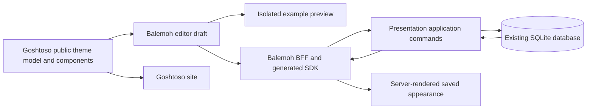

# Themes and presentation

Status: implementation contract following product and technical review. Product decisions and technical contracts below are consolidated. All new packages, endpoints, and tables describe required future implementation, not behavior already shipped.

## Goal

`Config > Presentation > Themes` lets an operator select any built-in Goshtoso theme, create named custom themes, and preview changes before applying them to the Balemoh instance. Saved presentation settings are shared by visitors and survive application restarts.

The milestone is pre-v0.1.0 exploration. Its first supported journey is choosing or editing a theme, inspecting an isolated preview, and saving a persistent global selection.

## Related contracts

- [Homepage widgets](2026-10-14-home-widgets-design.md)
- [Host telemetry](2026-10-07-host-telemetry-design.md)
- [Goshtoso integration journal](../../goshtoso-snag-journal.md)
- [Presentation navigation](../../../ui/internal/view/presentation.templ)
- [Current console shell](../../../ui/internal/view/shell.go)

## Agreed decisions

| Area | Contract |
| --- | --- |
| Theme catalog | Support every built-in theme in the selected Goshtoso release. |
| Library ownership | Extract the existing Goshtoso site playground and editor into public Goshtoso components. |
| Consumers | Both the Goshtoso site and Balemoh use the extracted public components. |
| Configuration scope | Saved theme selection and customizations are global to the Balemoh instance. |
| Persistence | Balemoh owns backend persistence. Browser storage is not the authority for saved settings. |
| Editing | Changes remain in an isolated preview until Save. |
| Save | Save applies the selection/customization globally and persists it. |
| Applying saved settings | After persistence succeeds, perform a full-page navigation/reload in the saving browser. Other open pages receive the configuration on their next navigation or reload; this milestone adds no live theme-propagation channel. |
| Custom themes | Support multiple named custom themes alongside the built-in catalog. |
| Theme duplication | Duplicating a custom theme creates an independent definition with a new identity. Later edits to the original do not change the copy; there is no live custom-theme inheritance. |
| Built-in integrity | Customizations preserve the original Goshtoso presets. |
| Preset updates | Custom themes persist a complete snapshot of their supported theme values. Later changes to Goshtoso presets do not update saved custom-theme values. Base-preset identity/version is provenance, not live inheritance. |
| Color mode | One persisted global setting: System, Light, or Dark. System follows each visitor's operating-system preference. |
| Preview content | Representative Balemoh sidebar, cards, table, forms, and states, with example data. |
| Font sources | Support system/local fonts, on-demand Google Fonts, and application-hosted fonts together. These are complementary sources, not exclusive deployment modes. |
| Custom font uploads | Operators can upload their own fonts alongside the application-hosted catalog. Uploaded files and their catalog metadata survive application restarts. |
| Font upload formats and limit | Accept WOFF2, WOFF, TTF, and OTF, including valid variable-font variants, with a maximum of 10 MiB per uploaded file. |
| Variable-font editing | The first delivery loads variable fonts with their default axis values and ordinary interface weight/style behavior. It exposes no custom variation-axis controls and persists no user-defined axis overrides. |
| Uploaded-font selection | Each uploaded file is an independent selectable item, identified by name, weight, and style. The first delivery does not group multiple uploaded files into a selectable family bundle. |
| Font file replacement | Every new upload creates a new font reference, including uploads with an existing filename or display name. Existing themes keep their previous font reference and file until explicitly edited. |
| Deleting items in use | Block deletion of the active custom theme and any uploaded font referenced by a saved custom theme. Operators must select another theme or remove font references first. No automatic fallback replacement. |
| Concurrent editing | Reject stale saves, preserve the editor draft, and explain that the saved configuration changed. No last-writer-wins overwrite. |
| Unsaved changes | Warn before discarding edits when switching themes or leaving the editor. Cancel keeps the draft and current preview. |
| Contrast inspection | Show contrast findings as advisory feedback. Low contrast alone never blocks Save; malformed or unsupported theme values remain validation errors. |
| Appearance-load failure | Render temporarily with Goshtoso/System and a visible warning when saved appearance cannot be loaded. Preserve saved configuration unchanged. |
| Manual recovery | Provide a temporary Goshtoso/System editor mode even when saved appearance loads successfully. Entering recovery does not change global settings; changes become global only through a successful explicit Save. |
| Application model | Balemoh is single-user and has no application authentication. Theme/font management follows the existing editing model; this feature adds no users, roles, or authorization layer. |

## Verified starting point

Balemoh's UI currently selects Goshtoso v0.3.3 and App Shells v0.1.9-0.20260910224508-5b2222e54637. Its Themes tab is a placeholder. The shell defaults to Goshtoso and system color mode, with browser preference persistence enabled.

The public `github.com/araihu/goshtoso/themes` package exposes `BuiltIn()`. The inspected catalog contains 16 themes. It supplies canonical keys and labels, while consumers own display order and defaults.

| Key | Canonical label |
| --- | --- |
| `90s` | 90s |
| `araihu` | Arai Hû |
| `arctic` | Arctic |
| `christmas` | Christmas |
| `dracula` | Dracula |
| `goshtoso` | Goshtoso |
| `halloween` | Halloween |
| `high-contrast` | High Contrast |
| `industrial` | Industrial |
| `minimal` | Minimal |
| `modern` | Modern |
| `neo-brutalism` | Neo Brutalism |
| `news` | News |
| `pastel` | Pastel |
| `prototype` | Prototype |
| `zombie` | Zombie |

The implementation must enumerate the selected release's public catalog rather than duplicate this snapshot as a second source of truth.

The Goshtoso homepage playground lives in `site/internal/pages/demo/contentpages/start/landing.templ`. It already isolates preview styles in a separate document, but its theme picker is a curated five-theme subset. It also depends on site-owned example data and asset wiring.

The existing editor lives in `site/internal/pages/demo/contentpages/docs/theme.templ` and `site/assets/js/src/theme-page.js`. It supports typography, border radius, color roles, live previews, reset, contrast inspection, and CSS export. Its font picker currently loads Google Fonts on demand. These are site implementation details, not public component APIs.

Goshtoso v0.4.4 was the latest published release inspected during discovery. The fetched main revision was `68a31eea763e84bf6425172129c0c6e6f10675ed`; the editor and playground still lived under the site. The extraction release and compatible dependency versions remain to be selected during implementation.

## Ownership contract

Balemoh is a single-user application without application authentication. Theme/font operations follow the same access model as existing catalog edits. Shared/global state means instance-wide settings across browsers, not a multi-user permission model. This spec adds no login, administrator role, or RBAC prerequisite. Content validation, revision checks, and reference integrity remain ordinary data-correctness requirements.

| Owner | Responsibility |
| --- | --- |
| Goshtoso public components | Theme editing controls, playground composition, preview configuration, and an explicit editable-state contract. |
| Goshtoso runtime/assets | Runtime behavior and assets required by the extracted components. |
| Goshtoso site | Site composition and example data, consuming the same public APIs as external applications. |
| Balemoh UI | Themes tab, representative preview content, draft interactions, and backend integration through the generated client. |
| Balemoh API | Authoritative global settings, named custom-theme commands, and uploaded-font management. |
| Balemoh storage | Durable custom-theme definitions, active presentation settings, and uploaded font assets/metadata. |

The public component/data contracts are defined below. The reusable components must accept consumer-provided content and state without depending on site routes, site storage keys, or Balemoh endpoints. Saving is a consumer responsibility.

## Editor scope

The extraction preserves the existing editor's capabilities: built-in theme selection, title/body typography, radius, light/dark and shared color roles, preview, reset, contrast inspection, and CSS export. This follows the requested reuse of the existing editor; additional import workflows or arbitrary raw stylesheet editing are not assumed.

Contrast feedback is informative. The editor may display problematic pairs and computed ratios, but Save is not gated on a contrast score. This does not relax validation of identifiers, supported tokens, font references, or value syntax. Contrast inspection must not claim to certify the entire application.

Reset affects the draft preview first. Applying a reset globally still requires Save. Built-in selection and editor token metadata must come from the selected Goshtoso release, without copying a second catalog or theme-token map into Balemoh.

## State and persistence

The conceptual model has three separate kinds of state:

- Built-in themes come from Goshtoso and remain immutable.
- Named custom themes have stable identity, a display name, a complete snapshot of supported theme values, base-preset provenance, and a revision used for conflict detection. Definition v1, API, and persistence sections define the fields and bounds.
- Instance presentation settings select a built-in or custom theme and a global System/Light/Dark mode.

An editor draft is separate from saved instance state. Preview changes cannot update the saved selection or affect another visitor. The first delivery protects unsaved edits with a discard warning; it does not promise browser-persisted draft recovery. Browser storage must not override authoritative global settings.

The API, migration, and public editor-state contracts below are required implementation work. No theme-management API currently exists in Balemoh.

## Saved values and preset updates

Creating a custom theme materializes the supported theme values of the selected preset plus the operator's changes. Persist both light/dark values, shared colors, typography references, radius, and other values included in the public theme-definition contract. The saved definition is not just an override map that falls through to a mutable installed preset.

The originating preset key and library version are provenance. Rendering a custom theme uses its saved values; updating the dependency or editing a built-in preset cannot silently replace them. Any palette aliases or other references to mutable preset values must be resolved into the saved definition rather than reintroducing live inheritance indirectly.

This freezes supported theme configuration values, not the entire component stylesheet or external font bytes. Component rendering can still change with a library upgrade, and remote font availability still follows the selected font source. An upgrade that changes the supported theme format must explicitly handle existing saved definitions. New or unsupported tokens need a documented compatibility policy; they do not authorize overwriting saved values. Direct use of a built-in preset continues to use the installed release's definition.

## Typography sources

The editor exposes all supported font sources together. A theme's typography selection identifies its font source and font family; system/local fonts use browser-available stacks, Google Fonts are loaded on demand, and application-hosted fonts use assets served by the application. FontRef in Definition v1 defines the persisted reference format.

The public editor accepts a consumer-provided font catalog and source integration. Balemoh owns font availability and hosted asset delivery; the reusable editor must not hardcode Balemoh asset routes. Font download failure must leave text readable through a fallback stack. Selecting an external font must make its external source clear.

Application-hosted fonts include both the distributed catalog and operator-uploaded files. Uploaded fonts are reusable across custom themes. Themes reference stable font identities rather than operator-supplied filesystem paths. Balemoh owns durable file storage and catalog metadata, while the public editor consumes the resulting font catalog.

Each uploaded file appears as a separate selectable item with a user-facing name, weight, and style. Selecting an uploaded font references that file's immutable ID rather than a family assembled from other uploads. Files with the same embedded family name remain distinct catalog items; adding a regular, bold, or italic file does not change another item's membership or alter saved theme references. The runtime must keep distinct file references distinguishable even when their embedded family names match. The font catalog and validation sections define metadata fallback and per-file CSS aliasing.

Accepted upload formats are WOFF2, WOFF, TTF, and OTF, including variable fonts in a supported container. The per-file limit is 10 MiB, exactly 10,485,760 bytes, measured on the uploaded file bytes. Multipart framing overhead is handled separately and does not reduce the accepted file-size limit.

The backend validates file contents and supported font structure, rather than trusting a filename extension or client-supplied media type. Reject oversized, malformed, or unsupported uploads without publishing a usable font reference or changing saved presentation. Validation must also bound any decompression or parsing work required by compressed font containers; a 10 MiB upload cap alone is not a decompressed-size guarantee. The font validation section specifies container readers and processing limits.

Successful uploads remain available after restart without requiring the original external source. Uploading a new file creates a new stable reference; it never replaces bytes behind an existing reference or rewrites themes that use the previous font. Variable-font acceptance requires retaining the supported font data and metadata needed for correct loading. The first delivery uses default axis values and ordinary interface weight/style behavior. Custom axis controls and user-defined axis overrides are deferred beyond this delivery; accepting a variable-font file does not imply an axis editor.

## Deleting themes and fonts

The active custom theme cannot be deleted. Selecting and saving another theme first makes the previous theme eligible for deletion. Built-in presets remain immutable and are not deletable.

An uploaded font cannot be deleted while any saved custom theme references it, whether that theme is active or inactive. The UI identifies the referencing themes so an operator can change or remove those references. The backend checks current active selection and references when executing deletion; an outdated page cannot bypass this rule.

A rejected deletion leaves the theme catalog, uploaded assets, saved references, and active settings unchanged. Theme or font deletion never silently chooses a fallback. The API section defines routes and error responses.

## Main journey

1. Open `Presentation > Themes` and load the current global selection plus the built-in/custom catalog.
2. Choose an existing theme or begin a named customization from a base theme.
3. Change supported values and inspect the isolated Balemoh example composition.
4. Save to persist the theme and global mode.
5. Only after persistence succeeds, navigate/reload the saving browser's full page and render the saved instance configuration.

Save failure must retain the draft and provide retry feedback without reloading or claiming that the global configuration was saved.

The saving browser returns to `Presentation > Themes` after success. A native POST/Redirect/GET flow is the default design; an HTMX save may request equivalent full-page navigation after confirmed success. Both must avoid resubmitting the mutation on refresh. Already-open pages in other tabs or browsers keep their current appearance until their next navigation or reload. The first milestone requires no theme broadcasts, additional SSE subscriptions, or forced reloads of other visitors.

## Concurrent edits and recovery

An editor loads the revisions of the saved custom theme and instance settings it intends to change. Save submits those expected revisions with the draft. The backend checks the affected records before committing changes. If another save changed a relevant revision, it rejects the stale command and leaves saved themes and active instance settings unchanged. A save that both updates a theme and activates it must not partially succeed.

The UI keeps the submitted draft and its original expected revisions, displays a conflict message, and performs no full-page reload. Retrying the same stale draft cannot overwrite the newer saved version. Recovery must let the operator inspect the current saved state without silently replacing the draft or updating its revision to bypass conflict detection.

The API and BFF sections define revision, conflict inspection, and recovery contracts. There is no automatic merge or force-overwrite.

## Unsaved changes

Changing an editable value marks the editor draft dirty. Switching to another theme or navigating away while dirty must request confirmation before discarding edits. Cancel keeps the same draft and preview; confirming discards only local edits and does not mutate saved themes or instance settings.

Tabs within Presentation keep mounted editor state. Moving between Icons and Themes must not discard edits or require confirmation when the draft remains mounted. Leaving the document uses the browser's standard unsaved-changes warning where supported; the application does not promise recovery after a forced close or browser termination.

Save failure or conflict keeps the dirty state and its navigation protection. After confirmed Save success, clear the dirty flag before the intentional full-page navigation so the operator is not asked to discard already-saved changes.

## Runtime topology



Draft preview stays in the browser. Only explicit management commands or Save cross into persistence. File upload changes the font catalog, not the active theme; selecting the uploaded reference in a draft still requires Save to change global appearance.

## Public Goshtoso contract

The following APIs are the target of the extraction, not APIs present in the inspected releases. Their responsibilities and data contract are fixed by this spec. Implement them upstream, migrate the Goshtoso site to them, publish a durable compatible release, and then pin that exact release in Balemoh's root and UI modules. A local workspace replacement is not delivery evidence. A future release number is not invented here.

| Package | Contract |
| --- | --- |
| `themes` | Keep `BuiltIn()` compatible. Add versioned `Definition`, `FontRef`, `TokenSpec`, `Preset`, `Materialize`, `Validate`, `RenderCSS`, `RenderFontCSS`, `ResolveFont`, `CatalogRevision`, `Version`, and `DefaultFonts` APIs. These contain no templ, HTTP, database, or application-storage dependencies. |
| `components/themeeditor` | `ThemeEditor(Config)` returns a concrete renderable instance following Goshtoso's component model. Config owns `ID`, `Initial`, `Catalog`, `Fonts`, `PreviewID`, `InitialPreviewMode`, `InputName`, `Actions`, `RootClass`, and `RootAttrs`. |
| `components/themeplayground` | `ThemePlayground(Config)` renders an iframe preview host. Config owns `ID`, same-origin relative `Src`, `Title`, `RootClass`, and `RootAttrs`. `Frame(FrameConfig)` renders the isolated document with `ID`, `Title`, consumer-owned `Content` and `Head` templ slots, `Fonts`, optional same-origin `FontCatalogURL`, and the public preview runtime. The first validated editor message supplies the definition. |
| `assets` | Serve the editor/frame runtime and required metadata through the existing public asset handler. Source and compiled assets ship together. |

`themes.Preset(key)` returns a caller-owned materialized definition and provenance for a built-in. `Materialize` applies a validated draft to a definition. `Validate` checks the versioned token/value/font-reference grammar. `RenderCSS` emits declarations for the library-owned custom-theme scope; callers cannot pass arbitrary selectors or raw CSS. Font URLs come from a consumer font resolver, not from an uploaded theme string. Exact Go representation may use named types, but wire fields and behavior below must stay consistent.

Theme selector options show literal primary, secondary, and surface swatches and the definition's title typeface. The selected trigger repeats the swatches and title typeface. Compose Goshtoso Select with public `Option.Leading` and `Option.LabelAttrs`; use `themeeditor.Config.PresetOptions()` so the site and Balemoh share preview rules. Private font aliases load on demand and do not modify saved font identities or host typography.

The token registry marks editable inputs and derived dependencies. Materialize recomputes derived roles when their editable inputs change, then emits literals for the entire definition. Later rendering performs no preset lookup. Explicit editable values remain operator-owned and contrast stays advisory.

Global `colorMode` is a separate consumer form field labelled Instance mode. The editor's sun/moon icon toggle exposes an accessible action label and pressed state. It selects only `previewMode` and the color-role panel being edited; it never mutates a global preference store. Inspecting a light variant does not force the saved instance mode to Light. Both the preview label and Save summary identify which mode is temporary and which mode will be saved. Changes to the consumer's candidate instance mode update the preview unless an explicit inspection mode is selected.

The editor renders no persistence form, sends no storage request, and reads/writes no application preferences. It can be nested in a consumer form. `InputName`, defaulting to `definition`, identifies a hidden input containing the complete serialized definition. Initialization and every change keep it synchronized with the visible controls and preview. `Actions` is a consumer-owned slot for Save/reset-related product actions; library control buttons use `type="button"`. Font upload controls are consumer-owned and cannot introduce nested forms.

The editor dispatches bubbling `themeeditor:change` with `{id, definition, previewMode, dirty, valid}` and `themeeditor:ready` after initialization. It accepts root-targeted `themeeditor:load` with a validated definition, optional `fonts` catalog, or optional `previewMode`, and `themeeditor:committed` after a confirmed save. Fonts-only and mode-only loads preserve raw incomplete color input. `load` must not bypass the consumer's discard guard. Internal node IDs are namespaced by Config.ID. No integration may inspect Alpine private state or copy site-owned markup/runtime. Two instances must not share drafts or preview channels.

The site composes the same components with its own example data and persistence policy. Balemoh provides its representative preview and backend integration. Extraction preserves the existing editor's typography, colors, radius, reset, contrast, and CSS export capabilities. Font-provider options are injected; Google Fonts is not hardcoded as the only provider.

### Definition v1 and frozen values

```text
Definition {
  schemaVersion: 1
  tokens: map<registered token key, ColorValue>
  typography: {title: FontRef, body: FontRef}
  radiusRem: number
  provenance: {presetKey, goshtosoVersion}
}
ColorValue = {space: "srgb", channels: [r,g,b], alpha}
           | {space: "oklch", channels: [l,c,h], alpha}
FontRef = {source: "system"|"google"|"bundled"|"upload", id: string}
```

All numbers must be finite. sRGB channels, lightness, and alpha are in `[0,1]`; OKLCH chroma is in `[0,0.5]` and hue in `[0,360)`. Radius is in `[0,4]` rem. The full definition is at most 64 KiB encoded JSON, with at most 256 registered color tokens. Names are trimmed, nonblank, and at most 200 Unicode characters. Unknown fields, token names, sources, or unsupported schema versions are rejected. CSS expressions, selectors, URLs, declarations, and custom variation-axis values are not definition fields.

The v1 token registry covers the selected release's theme-owned light, dark, shared, and derived color roles, including muted text, control outlines, status text/action colors, and chart roles where supplied by the release. The generator uses the same theme sources and compiled palette as published Goshtoso assets. It resolves `var(...)`, palette aliases, inherited defaults, and `color-mix(...)` into literal sRGB/OKLCH values. Balemoh never scrapes computed browser styles or maintains a second hand-written preset map. An extraction acceptance test compares materialized presets against the compiled stylesheet's resolved values.

Palette selections in the editor become literals in the hidden definition. Exported CSS is generated from the validated snapshot, not reconstructed from a newer preset. Fonts and radius are explicit, including baseline defaults. The renderer maps the body role to the release's supported body/paragraph variable aliases so a preset-specific alias cannot fall back to a different live font stack. `provenance` is informational and never selects fallback values during custom-theme rendering. A schema change requiring new roles introduces an explicit versioned migration with deterministic new-role defaults, while preserving existing saved values. The current release must read v1; an unsupported saved schema uses temporary appearance fallback without rewriting the record.

### Font catalog and resolution

The editor receives `{source,id,label,weight,style,variable}` font entries. IDs, provider parameters, allowed family stacks, file URLs, MIME types, and fallbacks are resolved by the consumer's catalog, never accepted as arbitrary URLs from the theme definition. Title/body selectors use the same catalog. Catalog IDs have immutable meaning for v1; an incompatible provider mapping gets a new ID, and old saved references retain a resolver or require an explicit migration. A system entry contains an allowlisted browser family stack; Google entries cover the current site's curated font choices and load only when selected; bundled entries resolve to packaged assets with their notices; upload entries resolve to individual immutable files. No Google Fonts discovery API or background mirroring is required for this milestone. The distributed catalog is a source capability, not a promise to bundle every external font.

An uploaded file gets a unique CSS family alias derived from its opaque font ID, so two files with matching internal family names cannot replace one another. The catalog displays the selected name, weight, and normal/italic/oblique style. Name comes from operator input or validated metadata; missing optional weight/style metadata is labelled unknown and uses normal CSS defaults, not invented file metadata. Variable metadata may describe an ordinary weight range, but no axis sliders or user-defined variation settings are emitted. Use `font-display: swap` and a configured generic fallback stack.

### Isolated preview protocol

Balemoh owns `GET /presentation/preview`; the frame contains example composition only and no live service/host catalog queries or mutation forms. The parent uses the public playground host and the frame uses `themeplayground.Frame`. Both load the same published assets. Parent and frame accept messages only when `event.origin` equals the page origin and `event.source` is the expected frame/parent window.

Protocol v1 messages are `themeplayground:ready` and `themeplayground:state`, carrying `version`, `instanceId`, monotonically increasing `sequence`, definition, and preview mode. The parent sends the latest draft after ready and on changes; the frame ignores older sequences, other instance IDs, unsupported versions, and invalid definitions. No HTML, JavaScript, stylesheet text, or arbitrary URLs cross this bridge. The frame applies state only to its own root and resolves fonts through the supplied catalog. A new uploaded-font ID may trigger a read-only refresh of `/presentation/fonts/catalog`; this appearance metadata/asset dependency is allowed, unlike live service/host data. The bridge still carries IDs rather than arbitrary URLs. This is style isolation for trusted example content, not a sandbox for user-supplied markup. Destroying either component removes its observers/listeners.

## API contract

These new endpoints are specified here for implementation in OpenAPI. They are not current endpoints. The core application owns `internal/application/presentation` and `internal/application/fonts`; the HTTP adapter maps commands/errors, the SQLite adapter owns transactions, and the UI uses the generated SDK. Goshtoso's pure `themes` data/validation package is allowed in the backend; templ/components/site imports are not.

Opaque resource IDs use `theme:` and `font:` prefixes with randomly generated UUIDs. IDs are never names, paths, or content hashes. Revisions are opaque decimal strings, compared exactly. Instance settings are initialized by migration with revision `"0"`, Goshtoso/System; a successful logical change increments the affected revision. A read failure never returns a synthetic revision `"0"`. Catalog revision identifies the published schema/preset manifest and is checked when creating from or selecting a built-in preset.

| Method and route | Input | Success and effect |
| --- | --- | --- |
| `GET /api/v1/presentation` | None. | 200, `{revision,selection,colorMode,resolvedDefinition,catalogRevision}` from one consistent read. Selection includes a custom theme's current revision when applicable. |
| `PUT /api/v1/presentation` | Save command below. | 200, saved settings and resolved definition. Save and activation commit atomically. |
| `GET /api/v1/themes` | None. | 200, catalog revision plus built-ins and custom summaries, ordered deterministically by source/name/ID. No font bytes. |
| `GET /api/v1/themes/{themeID}` | Custom ID. | 200, name, complete definition, revision, and active flag. Used by edit and conflict inspection. |
| `POST /api/v1/themes` | `{id,name,definition}` or `{id,name,copyFrom:{id,revision}}`. | 201, inactive custom theme. Client-generated ID is stable across a retry; exact replay returns 200 while the original revision/content remains unchanged, otherwise 409. Duplicate copies saved values, not today's preset. |
| `PATCH /api/v1/themes/{themeID}` | `{expectedRevision,name}`. | 200, rename only, including an active custom theme. Does not activate or modify its appearance. |
| `DELETE /api/v1/themes/{themeID}` | Required `revision` query parameter. | 204 if matching and inactive; reject active/changed themes. A repeated delete of a missing ID returns 404 with no mutation. |
| `GET /api/v1/fonts` | None. | 200, source/ID/name/weight/style/variable/format metadata and `usedBy` stable theme IDs plus labels. No binary data. |
| `POST /api/v1/fonts` | Multipart: stable client-generated `id`, optional `name`, exactly one `file`. | 201 after validation and durable storage. Exact same-ID/file/metadata retry returns 200; different contents with an existing ID return 409. A deliberately new upload uses a new ID even for identical bytes. |
| `GET /api/v1/fonts/{fontID}/file` | Upload ID. | 200 validated original bytes with `font/woff2`, `font/woff`, `font/ttf`, or `font/otf`; ETag is the byte digest, conditional reads may return 304. |
| `DELETE /api/v1/fonts/{fontID}` | Required `revision` query parameter. | 204 only if matching and unreferenced by every saved theme. Missing ID returns 404. |

### Atomic Save command

```text
{
  commandId: UUID,
  expectedSettingsRevision: string,
  colorMode: "system"|"light"|"dark",
  selection:
    {kind:"builtin", key, expectedCatalogRevision}
    | {kind:"custom", id, expectedThemeRevision, draft?:{name,definition}}
    | {kind:"newCustom", id, name, definition, expectedCatalogRevision}
}
```

Exactly one selection form is accepted. Built-in selection cannot carry edits. A custom selection without `draft` activates its current definition; with `draft` it updates that theme and activates it in the same transaction. `newCustom` creates the supplied new ID and activates it atomically. Creation from a built-in carries a full materialized snapshot. Existing custom IDs cannot be used as `newCustom`. All font references must exist and all referenced catalog entries must be valid for the selected manifest.

Within one write transaction: read current settings, check settings/catalog/theme revisions, validate all font references, insert/update the complete definition, replace its reference rows, update the active selection/mode, increment affected revisions, and write the successful-command receipt. No success body is sent before commit. Editing an inactive custom theme through Save also activates it, matching the agreed UI behavior; metadata-only rename does not.

The settings singleton retains the last successful `commandId`, normalized payload digest, and response receipt. An immediate exact replay returns that receipt without a second mutation. Reusing the ID with a different payload is 409. After an intervening presentation Save, the original expected revision is stale and retry returns 409; it does not reactivate an old theme. This bounded receipt is not an indefinite command-history service. Client-generated new IDs and CAS checks prevent duplicate theme creation after an uncertain response. New-theme/font creation records retain their creation payload digest so a same-ID retry cannot overwrite a later edit.

There is no force-save or implicit rebase. After transport failure, preserve the draft and report that outcome may be unconfirmed; retry with the same command/resource IDs or inspect current state. An API failure before commit changes nothing. A committed request whose response was lost is not falsely described as rolled back.

### Error envelope

Use the existing `ErrorResponse {code,message}` style, extended in OpenAPI for these endpoints with optional `fieldErrors`, `conflict {kind,id?,currentRevision?}`, and `usedBy`. Conflict kind identifies settings, theme, font, catalog, or command, so revisions from different resources cannot be confused. Codes are explicit; clients do not parse messages.

| HTTP | Code | Behavior |
| --- | --- | --- |
| 400 | `invalid_request` | Malformed/unknown fields, invalid name/token/reference, unsupported snapshot version, or invalid font contents. No mutation. |
| 404 | `not_found` | Missing theme/font. No mutation. |
| 409 | `conflict` | Stale settings/theme/font/catalog revision or reused command/ID with different contents. Keep draft and original expected revisions. |
| 409 | `in_use` | Active theme or referenced font cannot be deleted; include current references. |
| 409 | `limit_exceeded` | Catalog count/storage quota would be exceeded. No partial insert. |
| 413 | `upload_too_large` | File exceeds 10 MiB or declared/actual decoded data exceeds validation bounds. |
| 415 | `unsupported_font` | Unsupported font container, including collections and EOT. |
| 503 | `unavailable` | Storage or required catalog cannot be read/committed. Do not invent empty state. |

Missing required revision is 400, not a wildcard. A 409 may expose the target resource and its current revision for explanation; the editor must not silently adopt it to bypass conflict detection. Binary-file errors use the same JSON envelope. No theme/font response contains raw parser dumps or file paths.

## Persistence contract

Use the existing SQLite database and connection configuration, including foreign keys. Font bytes are SQLite BLOBs, following uploaded icons; there is no filesystem blob store or second backup boundary in this delivery. Metadata lists omit BLOBs. No font content is garbage-collected automatically.

| Table | Required fields and constraints |
| --- | --- |
| `presentation_themes` | `id` PK, `name`, `schema_version`, `definition_json`, `provenance_json`, integer `revision >= 1`, `creation_digest`. JSON is a complete validated snapshot; name is not identity and duplicate display names are allowed with ID disambiguation. |
| `presentation_settings` | Singleton `id=1`, `builtin_key` or `custom_theme_id` exclusively, `color_mode`, integer `revision >= 0`, last command ID/payload digest/response receipt. FK from custom selection to themes uses RESTRICT. |
| `presentation_fonts` | `id` PK, `name`, embedded family metadata if available, weight/style/variable metadata, `format`, `mime`, `byte_length`, `digest`, `data` BLOB, `revision=1`, `creation_digest`. File content and its identity are immutable. |
| `presentation_theme_fonts` | `(theme_id,role)` PK, `role` in title/body, `font_id` FK RESTRICT. FK to theme cascades its reference rows on deletion. Only uploaded-font references live here; system/Google/bundled IDs validate against catalogs. |

The duplicated reference rows are an index of the definition, not a second editable source of truth. Replace them in the same transaction as the JSON; tests assert agreement. Restricting FKs and current-revision checks prevent font deletion/save and theme activation/deletion races. The existing single-connection setup does not replace transaction requirements.

Apply the next available additive migration, without claiming a number that concurrent work may occupy. Initialize Goshtoso/System revision 0 and leave existing catalog/icons/dashboard data untouched. The down migration intentionally drops this feature's data and is not an operational rollback step. UI rollback leaves the tables intact. Existing SQLite backup/restore captures font bytes and metadata together; verify the supported backup procedure includes the database WAL consistently. There is no extra font volume to back up.

Bounds are constants for this delivery, not new environment-variable configuration: 128 custom themes, 256 uploaded files, 512 MiB total uploaded bytes, 64 KiB per definition, and 200 characters per display name. Check upload quota again inside the insertion transaction. A file may fit the 10 MiB per-file bound but still exceed the aggregate quota; report the appropriate code.

## Font validation and delivery

Accept original WOFF2, WOFF, TTF, and OTF bytes, including variable-font data, without converting stored files or merging faces. Detect signatures before parsing. Validate directories, offsets, lengths, required structural metadata, and variable metadata used for ordinary loading. The contract is bounded structural/metadata validation, not full glyph rendering, font repair, or a claim that every malformed glyph program is sanitized.

Use a byte-limited container/metadata adapter in `internal/adapters/fontdata`: standard-library zlib for WOFF and `github.com/andybalholm/brotli` v1.2.6 for WOFF2, already selected indirectly by the inspected UI module. Add it explicitly to the backend during implementation; no CGO or external font executable is required. Decode table data only as needed for structural checks and name/weight/style/fvar metadata; no glyph-outline reconstruction is required for this metadata contract. A dependency may supply container primitives only if it preserves these bounds. Do not call an unbounded converter and check length only afterward.

| Bound | Value |
| --- | --- |
| Raw file | 10,485,760 bytes, inclusive. |
| Multipart request | File limit plus 64 KiB of framing/metadata, one file and bounded text fields; enforce file size separately. |
| Decoded/reconstructed table data | 64 MiB per font, including the sum of table lengths. Reject over-limit declared sizes before allocation and stop actual decoding at limit + 1. |
| Table directory | At most 256 tables; checked arithmetic and no out-of-bounds/duplicate table ranges. |
| Metadata table | At most 1 MiB for a metadata table; bounded text records and UTF decoding. |
| Concurrent validation | One per API process; cancelled requests release their slot and temporary buffers. |

Read metadata rather than trusting client weight/style fields. Missing optional metadata is displayed as unknown, while ordinary CSS defaults keep text usable. Parse errors are 400, unsupported containers 415, size/decode bounds 413. Validation completes before the insert transaction; persistence rechecks the aggregate quota and duplicate ID. No catalog entry becomes visible for an incomplete/invalid upload. Stored original bytes, metadata, digest, and creation identity commit together.

The decoder library/version is an implementation pin, not a change to this API contract. Source inspection of `tdewolff/font` at `88a7f6b5691888bf23e957963fc9e49ff39dc16d` found WOFF2 `io.Copy` into a buffer before checking actual length. Its declared-size guard alone is insufficient evidence for the actual-output bound. This spec therefore does not select that converter as-is. A bounded primitive/adapter and corpus fixtures must prove the contract before the upload journey is accepted. This is a current upload constraint, not a requirement for an OS sandbox or broad font toolkit.

BFF serves uploaded bytes at `/presentation/fonts/{fontID}/file` through the generated client; API asset URLs are not exposed directly to the browser. Use `X-Content-Type-Options: nosniff`, the validated font media type, ETag, and `Cache-Control: private, max-age=0, must-revalidate`, so deletion is not hidden by a year-long cache. Bundled assets use versioned packaged URLs. Google Fonts is loaded through known catalog mappings in the browser, not a server-side arbitrary URL fetch.

## BFF, first paint, and recovery routes

| Route | Contract |
| --- | --- |
| `GET /presentation#themes` | Normal editor; preserves existing Icons tab and old icon routes. |
| `GET /presentation?appearance=recovery#themes` | Temporary Goshtoso/System chrome, actual saved draft/revisions, explicit recovery banner. No write. |
| `GET /presentation/preview` | Example-only frame. No live service/host queries or mutation actions. |
| `GET /presentation/fonts/catalog` | Read-only current font metadata for the frame resolver; no bytes or operational data. |
| `POST /presentation/save` | Decode bounded form JSON and expected revisions; call atomic API Save; on success 303 to `/presentation#themes`. |
| `POST /presentation/themes` | Create/duplicate inactive theme. |
| `POST /presentation/themes/{themeID}/rename` | Metadata-only rename. |
| `POST /presentation/themes/{themeID}/delete` | Revision-checked inactive delete. |
| `POST /presentation/fonts` | One-file multipart upload through SDK, without nesting inside the theme Save form. |
| `POST /presentation/fonts/{fontID}/delete` | Revision-checked delete. |
| `GET /presentation/conflict` with optional `themeID` query | Read-only current instance state and, when requested, the current custom-theme version in a separate tab. Also handles built-in/settings-only conflicts and a now-deleted theme. Does not write or replace the originating draft. |

The global request timeout stays unchanged for ordinary calls; the bounded font upload uses a separate 30-second UI-to-API context. Native Save submits exact retained draft values; enhanced Save keeps the editor mounted while pending. Disable the Save submitter for the in-flight request. On confirmed enhanced-save success, clear the dirty flag and do the full-page navigation. A native form submission suppresses the leave warning only for that intentional Save attempt; an error-rendered document restores draft dirty state and navigation protection. On 400/409/503 or transport failure, show a stable error region, focus its summary, and retain draft, source selections, expected revisions, and recovery mode. A failed Save does not replace the editor with the server's current definition.

For every full application document, load resolved appearance once before rendering through a presentation provider shared by handlers. Feed `DefaultTheme` and `InitialColorScheme` from that result into ConsoleShell and set `PersistPreferences=false`. Ignore old `goshtoso-theme`/`goshtoso-dark` keys without deleting them. No post-render appearance fetch is needed and no additional SSE connection is added. Existing partial updates retain the current document's appearance until a full navigation, as agreed.

Built-ins use their actual key. Custom definitions use the reserved `custom` scope and validated generated CSS. Reuse ConsoleShell's existing `Page.Head`, composing it with Balemoh's BrandHead. `themes.RenderCSS` emits unlayered custom properties under the fixed `:root[data-theme="custom"]` selector, with mode-specific rules scoped to that same root when needed. This outranks the inspected library's default `:root` values even though Page.Head precedes shell stylesheets. Test the cascade against the exact pinned assets; do not add a new App Shell head slot merely to reorder it. Fonts use unique generated aliases and validated font-face declarations.

The existing shell bootstrap receives the custom key and global mode and runs before body rendering. System mode must track OS changes through a matchMedia listener, while forced Light/Dark ignore them. The inspected ConsoleShell initializes System from OS but does not install that listener; the compatible upstream runtime must add this small behavior without introducing an appearance preference store. No extra public slot is required. Recovery/failure changes rendered chrome, never loaded revision data. Runtime behavior must not restore old browser/site preference keys.

Only public data/resolver/renderer output may enter the style component, never arbitrary uploaded stylesheet text. Literal color values, bounded numeric radius, generated aliases, and catalog-resolved URLs keep rendering independent of preset CSS expressions. Browser tests must verify initial custom appearance, first-paint order, computed values after all styles load, and all three global modes.

## Appearance-load failure

When saved appearance cannot be loaded or interpreted, render the page temporarily with Goshtoso and System color mode. Show an explicit warning that appearance settings could not be loaded and provide a retry action. This is display fallback, not a configuration reset: do not write default values, delete a custom theme, or rewrite font references.

| Read result | Rendering | Persistence behavior |
| --- | --- | --- |
| Saved appearance available | Apply the saved theme and global mode. | No write. |
| Authoritatively no saved configuration | Use the normal Goshtoso/System baseline. | Create settings only through an explicit Save. |
| Read failure or unusable saved appearance | Use temporary Goshtoso/System and show the warning. | Preserve existing records; do not treat failure as an empty configuration. |
| Font download failure with an otherwise valid theme | Keep the chosen theme and use its text fallback stack. | Do not rewrite the saved font or theme selection. |

The editor cannot submit a configuration update without the authoritative expected revisions needed for conflict detection. A failed load must not synthesize a fresh default revision and overwrite settings that were merely unavailable. Retry retains any existing draft; successful recovery applies the authoritative settings on the resulting navigation. This milestone needs no background polling or cross-browser propagation for recovery.

## Manual appearance recovery

An operator can open the Themes editor in a temporary Goshtoso/System mode without first failing to load the saved appearance. The recovery URL is `/presentation?appearance=recovery#themes`, also linked from the editor. Document it so recovery does not depend entirely on navigating a difficult custom theme.

Recovery changes the editor's surrounding presentation only. Load the actual saved theme, global settings, and authoritative revisions for editing. The isolated preview continues to display the draft being edited; entering recovery must not replace that draft with Goshtoso defaults or manufacture a new saved selection.

Show that recovery mode is temporary. It applies to the operator's editor navigation, does not propagate to other visitors, and does not become a new browser-stored preference. Reading state, opening the recovery URL, cancelling, or leaving recovery performs no global mutation.

An explicit Save uses the same validation, conflict detection, and atomic persistence contract as normal mode. After persistence succeeds, leave temporary recovery and perform the normal full-page navigation using the newly saved global appearance. A failed or conflicting Save retains the draft and recovery presentation. If authoritative settings cannot be loaded, the same unavailable-revision restriction applies; recovery is not a force-overwrite path.

## Theme management and conflict recovery

Custom-theme management includes create from a built-in/custom theme, duplicate under a new identity, rename, edit, and delete when inactive. Editing a built-in creates a named customization rather than modifying the preset. A renamed theme keeps its stable ID and font references.

Theme duplication is an independent copy by confirmed product decision. Copy the complete saved theme-value snapshot and provenance into a new theme identity, with its own revision and display name. Do not store a live parent-theme relationship or re-resolve the current preset while duplicating a saved custom theme. Editing or deleting the source custom theme does not modify its copies. Existing uploaded-font references may be reused because the referenced files are immutable; duplicating a theme does not require duplicating font bytes. Creating the copy does not activate it until an explicit Save applies the selection.

After a conflict, offer inspection of the current saved version in a separate read-only view. Returning preserves the draft and its original expected revisions. Starting a new edit from the current saved version requires an explicit decision to discard the old draft; it is not an automatic merge or force-save. Use `View saved version` for the separate read-only view and `Discard draft and reload` for the guarded replacement action.

Uploaded font bytes are immutable by confirmed product decision. Replacing a file means uploading a new font identity and explicitly updating referencing themes before deleting the old asset. An upload with the same filename or display name does not replace an existing asset. Existing references and active presentation remain unchanged until a theme Save changes them. The agreed formats and 10 MiB per-file limit still require a bounded validation implementation before accepting uploads.

## Target invariants

1. Every entry returned by the selected Goshtoso release's `themes.BuiltIn()` is selectable.
2. Creating or editing a custom theme never mutates a built-in preset.
3. A draft preview cannot restyle the surrounding editor or another visitor's page.
4. Saving a theme persists the global selection; restarting Balemoh restores it.
5. A failed save does not discard the draft or report persistence success.
6. System mode resolves against each visitor's OS; Light and Dark force the corresponding global mode.
7. Existing browser-only preferences cannot silently override a saved instance selection.
8. The preview uses example data and does not depend on live discovery, modify catalog data, or expose operational actions.
9. The public editor and playground can be consumed outside the Goshtoso site without importing its `site/` or `internal/` packages.
10. Switching tabs or editing draft values preserves unrelated form state, focus, scroll, and existing application streams. A successful Save intentionally performs full-page navigation; a failed Save preserves the draft without reloading.
11. A saved theme's uploaded-font references resolve after restart; invalid font uploads do not change saved presentation settings.
12. Deletion cannot remove the active custom theme or an uploaded font referenced by a saved theme. Rejected deletions leave persistent state unchanged.
13. A stale save cannot overwrite newer theme or instance settings. Conflict responses preserve the draft and commit no partial changes; retrying with the same stale revisions remains a conflict.
14. Cancelling a discard warning retains the draft and preview. Successful-save navigation does not trigger an unsaved-changes warning; failed saves and conflicts keep navigation protection active.
15. Low-contrast feedback alone does not disable or reject Save; invalid or unsupported theme values still fail validation.
16. Uploading another font file creates a distinct reference and does not modify the bytes, references, or appearance of themes using an earlier upload.
17. Editing or deleting the source of a duplicated custom theme does not change the copy's definition or identity. The copy's uploaded-font references remain protected while it uses them.
18. Supported static and variable fonts at or below 10 MiB are eligible for content validation; oversized, malformed, and unsupported files cannot publish catalog entries or alter active presentation.
19. An accepted variable font loads without custom axis settings. The first-delivery editor offers no variation-axis controls and does not write user-defined axis overrides into saved themes.
20. Updating a built-in preset or the Goshtoso dependency does not replace the supported theme values saved in a custom theme. Duplicating a saved custom theme copies its saved values, not the current preset definition.
21. Every uploaded file is a separate font selection with name, weight, and style. Uploads with matching family names or additional weights/styles cannot silently change an existing font selection.
22. Appearance-load failure renders temporary Goshtoso/System with a warning and performs no persistence mutation. An unavailable configuration is never treated as an empty configuration for Save.
23. Entering manual recovery changes only the editor's temporary presentation, loads the actual saved state and revisions, and performs no global write. Only successful explicit Save applies edited settings globally and exits recovery.

## Acceptance direction

Validate built-in catalog completeness, custom-theme persistence and restart behavior, preview isolation, successful-save full-page navigation, failed-save draft retention without reload, global color modes, and consumer compilation against published component APIs. Exercise representative Balemoh UI at narrow and wide widths, including keyboard use, selected/disabled/error states, light and dark variants, and blocked browser storage. Confirm that another open browser sees the saved configuration after its next navigation/reload, without adding a live theme-propagation stream.

The Goshtoso site must exercise the extracted components as a real consumer. Balemoh acceptance must verify that example preview controls do not reach live mutation endpoints. Theme-editable values must follow the public component contract; this spec does not authorize arbitrary executable content or unbounded raw stylesheet injection. Test active-theme and referenced-font deletion rejection at the API boundary, including a reference or active-selection change after the deletion page was loaded. Exercise two editors saving the same configuration: the stale editor must retain its draft, receive conflict feedback without reloading, and leave newer saved state unchanged on repeat submission. Exercise cancel/confirm on theme changes and navigation with a dirty draft, state retention across Presentation tabs, and absence of a discard warning after successful Save.

Font validation acceptance includes valid examples of each supported format, valid variable-font data, malformed contents, misleading extension/media-type metadata, and file sizes at and immediately above 10,485,760 bytes. A size-valid file is not automatically a valid font. Verify that rejected uploads leave saved themes and catalog entries unchanged, while accepted uploaded references survive restart. Browser acceptance must load an uploaded variable font with default axes and ordinary interface weight/style behavior, without requiring axis controls or persisted custom variation settings.

Font-selection acceptance includes separate regular/bold/italic files with matching embedded family names. Each must appear independently with its name, weight, and style. Adding another file must not alter a theme that references an earlier upload.

Preset-update acceptance saves a custom theme, changes the installed preset's values in an isolated fixture, and verifies that the custom theme and its independent duplicate retain their saved values. Check that palette aliases do not resolve against the changed preset. This test does not assert identical pixels across component-library upgrades.

Failure acceptance distinguishes an empty instance from a failed appearance read. Inject unavailable and unusable-configuration responses, verify the temporary Goshtoso/System warning, and verify that settings and font references remain unchanged. A save without authoritative revisions must not overwrite saved state. After recovery, a fresh page must use the saved configuration rather than persisting the fallback. Test remote font failure independently; temporary Goshtoso/System fallback must not reset the saved theme or font references.

Manual-recovery acceptance starts with a valid custom theme, opens the documented recovery URL, and verifies Goshtoso/System editor chrome with the original theme/settings/revisions still loaded. Another browser must keep the saved global appearance. Verify draft preservation after failed/conflicting Save, no write on entry/cancel/exit, and successful Save followed by normal global rendering without a persisted recovery override.

## Technical review closure

| Concern | Closed contract |
| --- | --- |
| Reusable library boundary | Pure `themes` data/validation plus public ThemeEditor and ThemePlayground; site and external consumer tests use the same packages/assets. |
| Saved-value independence | Definition v1 materializes complete literal values, including derived roles, without mutable preset/palette references. |
| Save consistency | One revision-checked transaction owns custom-theme changes, reference rows, global selection, and bounded replay receipt. |
| Font handling | Per-file immutable IDs, bounded container/metadata validation, original bytes in SQLite, and a metadata catalog. |
| First paint | Reuse Page.Head with a tested custom root scope; disable browser preference restoration and add upstream System-mode OS tracking. |
| Recovery | Explicit URL, real saved state/revisions, local default chrome, no implicit write or revision bypass. |
| Delivery versions | Pin compatible published artifacts after extraction. An invented future version or local go.work is not fulfilled delivery evidence. |

No product questions or alternate technical architectures remain open in this document. Dependency publication pins and the next migration number are implementation artifacts resolved at delivery without changing these contracts. This spec does not claim the future parser, APIs, components, or migration have already been implemented or validated.

## Acceptance ledger

Each row requires HTTP/server-state checks and browser coverage when it has a UI. Effect count means durable logical changes, not temporary preview work.

| Starting state | Action | Expected response | Preserved input/context | Destination/focus | Effect count |
| --- | --- | --- | --- | --- | --- |
| Clean editor, current revisions | Save built-in or custom draft | API 200, BFF JSON receipt for fetch or 303 for HTML after commit | Selected identity/mode | `/presentation#themes`, saved state | One atomic save |
| Exact last Save replay | Retry same command/payload | Same receipt, no new mutation | Command/resource IDs | Fresh saved page | Still one |
| Another Save committed | Retry stale draft | 409 conflict | Entire draft, original revisions, recovery flag | Error summary; no reload | Zero |
| Save transport outcome unknown | Retry or inspect | Same IDs; receipt or explicit conflict | Entire draft | Retry/current-version inspection | At most one original save |
| Invalid definition or missing font | Save | 400/404, no commit | All draft inputs | Error summary/field | Zero |
| Active custom theme | Delete, including a forged request | 409 in_use | Selection and record | Inline delete error | Zero |
| Referenced uploaded font | Delete | 409 with referencing theme IDs | File and saved references | Usage/error region | Zero |
| Unreferenced font or inactive theme | Matching-revision delete, then repeat | 204 then 404 | Other records | Catalog | One deletion |
| Valid new font ID/file | Upload, then exact same-ID retry | 201 then 200 | Same immutable ID/bytes | Font picker; theme draft retained | One upload |
| Same font ID, different bytes | Upload | 409 conflict | Existing file/themes | Upload error | Zero |
| Invalid/oversized/over-quota font | Upload | 400/413/415/409 as defined | No partial record | Upload error and retained theme draft | Zero |
| Appearance read unavailable | Open/retry page | Default chrome plus warning | Saved config and existing draft | Same page/retry action | Zero |
| Valid difficult custom theme | Enter recovery | Default editor chrome, real state | Actual definition and revisions | Recovery editor | Zero |
| Dirty draft | Switch theme/leave, cancel warning | Stay in current edit | Draft and preview | Initiating control | Zero |
| Dirty draft after save failure | Confirm discard/reload | Current saved state after confirmation | Saved records | Reloaded editor | Zero |

Test unsupported schema handling, new/missing token compatibility, preserved snapshots after a preset update, independent copies, and correct title/body font references. Verify rollback of every multi-record Save failure. Upload fixtures cover all four containers, variable defaults, same-family separate files, deceptive metadata, declared/actual decompression bounds, the exact 10 MiB boundary, and restart persistence. Include quotas and deletion/save races against server truth.

The UI matrix covers every built-in preset in Light/Dark, System-mode OS changes, narrow/wide layouts, dirty/invalid/conflict/recovery states, keyboard controls, draft retention across Presentation tabs, and blocked browser storage. Test iframe origin/source/instance/sequence rejection and disposal, no operational requests from preview, and no new theme SSE stream. Contrast is advisory, not an accessibility certification. Save screenshot/evidence manifests at implementation acceptance; documentation review is not browser verification.

## Operational contract

Use the current single-user, unauthenticated application model. Emit bounded diagnostics for appearance fallback, unsupported snapshot schema, font rejection category, storage failure, and conflict. Log resource/command IDs and reason codes, not font bytes, full drafts, or uploaded filesystem names. No separate telemetry stack is required.

Additive migration and SQLite backup/restore preserve selected theme, definitions, font references, and bytes together. Roll back UI/API binaries without dropping theme tables; do not run the destructive down migration as routine rollback. Verify that backup tooling takes a consistent SQLite snapshot, rather than assuming that copying only the database file captures an active WAL.

## Maturity receipt

Stage: pre-v0.1.0 exploration. Current journey: choose/edit, preview, save, restart. Trust model: one operator, no application authentication, typed persisted state, isolated trusted example content, and uploaded font files receiving bounded structural validation. Current acceptance gates are the public consumer contract, atomic revision handling, bounded uploads, restart persistence, and the ledger above. No RBAC, multi-user infrastructure, OS sandbox, arbitrary theme-code execution, or indefinite compatibility service is introduced. The v0.1.0 candidate revisits supported-format resilience, migration coverage, and restore/release guarantees for its declared deployment. These future gates are not prerequisites for this exploratory delivery.

## Navigation revision, 2026-10-27

Themes is the saved-theme selection and preview surface. Global mode and Apply
remain here. Creation and editing move to `/presentation/themes/editor`, reached
through Create from this theme and Edit theme. Presets create independent custom
snapshots. The editor owns name, colors, typography, fonts and management actions;
its explicit Save and apply globally retains the existing atomic save behavior
and returns to Themes. No new storage or mutation API is introduced.

### Site identity update, 2026-10-27

Logo and icon are independent uploaded assets. Logo renders in navigation; icon
supplies favicon, touch icon and manifest. Each field uploads on selection and
can restore its own default. Save atomically persists/applies both with the
theme. Existing shared branding migrates to both references without changing
its appearance. Footer attribution always retains the Balemoh identity.
