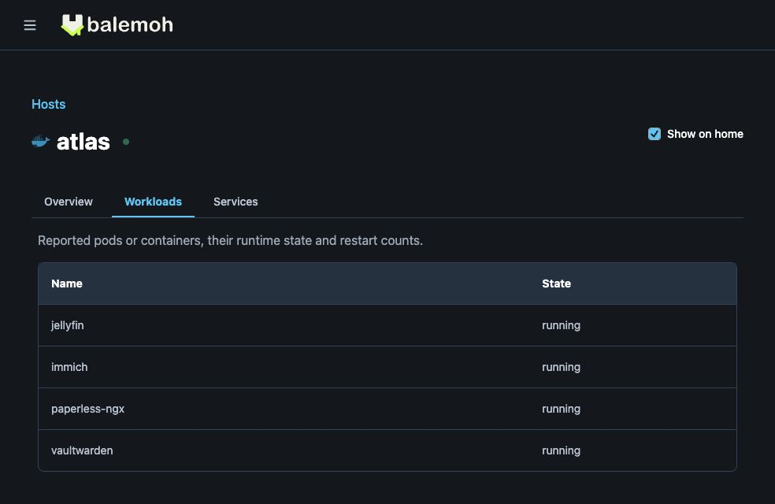

# Basic host telemetry

Host telemetry shows CPU and memory usage for Docker hosts and Kubernetes nodes,
with a cluster summary for Kubernetes. Open a host to inspect its recent history
and reported workloads, or select it to show readings on your homepage.

Telemetry is optional and separate from service discovery. Discovering services
does not enable CPU or memory collection. These are host measurements, not
per-container or per-pod CPU and memory readings.

## Read a host

1. Open **Hosts** in your Balemoh instance and choose a machine or cluster.
2. In **Overview**, check the latest CPU and memory readings and the observation
   and receipt timestamps. CPU is a share of total CPU capacity; memory includes
   used and total bytes as well as a percentage.
3. Choose **Last hour** or **Last 24 hours** to inspect one-minute history.
   Hover or tap a chart to read a sample. Missing minutes remain gaps.
4. Open **Workloads** for reported containers or pods and their runtime state.
   Kubernetes pods also include namespace and restart count. Clusters have a
   **Nodes** tab; root host pages have **Services** for related catalog entries.
5. Select **Show on home** to keep that host's readings on your homepage.


This screenshot uses generated measurements in a local instance.

The page updates automatically while it is open. **Refresh** requests the latest
stored report; it does not force an agent to collect a new measurement. Agents
collect once per minute, and retained history covers the last 24 hours.



The workload names and states above are synthetic examples.

## Enable collection

On each collecting API or agent process, enable an existing Docker or Kubernetes
source and set:

```dotenv
BALEMOH_TELEMETRY_ENABLED=true
```

Restart that process after changing its configuration. For federated agents,
keep the existing source identity, gateway URL, and source credential. Telemetry
uses the same registered credential as discovery. Update the gateway API and UI
before enabling newer agents.

The [API environment reference](../../reference/api-environment/index.md) lists
configuration names and defaults. [Federated agents](../federation/index.md)
covers connecting remote machines to a gateway.

### Docker hosts

Run the collector on the Linux machine it observes, using that machine's local
Unix Docker socket. When the agent runs in a container, add these mounts and
environment settings to its existing configuration:

```yaml
volumes:
  - /var/run/docker.sock:/var/run/docker.sock:ro
  - /proc:/host/proc:ro
environment:
  BALEMOH_TELEMETRY_ENABLED: 'true'
  BALEMOH_HOST_PROC_PATH: '/host/proc'
```

The proc mount and socket must belong to the same host. A remote Docker endpoint
cannot provide host CPU and memory through this collector. No privileged mode
or host PID namespace is needed. The Docker socket still grants substantial host
access; mounting it read-only does not make the Docker API read-only.

CPU needs two readings, so it can be unavailable during the first collection.
Memory uses total memory minus available memory. Docker Desktop readings describe
its Linux VM when that VM's proc filesystem is mounted, not the macOS host.

### Kubernetes clusters

The agent uses the Node Metrics API for CPU and memory. Metrics Server must be
available, and the agent's existing ClusterRole needs these read-only rules:

```yaml
- apiGroups: ['']
  resources: ['nodes', 'pods']
  verbs: ['list']
- apiGroups: ['metrics.k8s.io']
  resources: ['nodes']
  verbs: ['list']
```

Without node metrics access, inventory and heartbeat can still arrive. A cluster
summary is unavailable until every listed node has the relevant measurement.
Pod inventory follows the configured namespace scope. Node readings and cluster
totals include the whole node, including other namespaces.

## Understand reporting status

| Status | Meaning |
| --- | --- |
| Reporting | Observation and receipt are no more than three minutes old, with CPU and memory available |
| Partial data | A recent report arrived, but at least one CPU or memory measurement is unavailable |
| Stale | The last observation or receipt is more than three minutes old |
| No telemetry | No observation has arrived for that host |

**Stale** does not prove that a machine is offline. Check the agent and its path
to the gateway. **Partial data** can mean collection is starting, the proc mount
is missing, or Kubernetes metrics access is unavailable. Missing values never
become zero usage.

An unavailable workload inventory is different from an empty inventory. Truncated
lists are marked incomplete. Docker restart counts and per-workload CPU and
memory are not collected. Kubernetes node readiness is shown separately from
telemetry reporting status.
