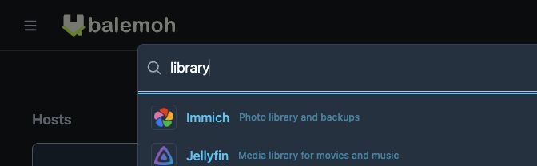

# Search services

Search finds services on your Balemoh homepage by display name, description, or
address. Use it when you know which app you want and do not want to scan its cards.
Matching ignores letter case and checks whether the query appears in those fields.

## Find and open an app

1. Open the homepage of your Balemoh instance. Pin at least one service from
   [Staging](../discovery/index.md#choose-what-appears-on-your-homepage) first.
2. Press **Command+K** on macOS or **Ctrl+K** on Windows or Linux. You can also
   start typing while focus is outside a form field to open search with that text.
3. Type part of a service name, description, or address. Results narrow as you type.
4. Click a result, or use the arrow keys to focus it and press **Enter**.
   The service opens in a new tab.

For example, typing `argo` finds a homepage service named Argo CD. A distinctive
part of its URL also works, even if you renamed the card.

This local instance uses synthetic services. The query `library` matches the
descriptions of both Immich and Jellyfin.

| Key | Action |
| --- | --- |
| Command+K or Ctrl+K | Open search, or focus and select the current query |
| Down arrow or Up arrow | Move between results that have an address |
| Enter in the search field | Open the first matching result that has an address |
| Escape in the search field | Close search |

Typing in an input, textarea, or editable field does not trigger type-to-search.
The shortcut also leaves another open dialog or menu alone.

## If a service does not appear

Search covers the service cards on your homepage. It does not search hosts, the
icon library, unpinned Staging entries, or the contents of an app. An empty
homepage has no service search.

If you see **No matching services**, shorten the query or try the service's
address. If the service is still absent, open Staging and check that it is live,
visible, and pinned. Missing and hidden services do not appear on the homepage.

A matching service without an address appears as **No public address** and cannot
be opened from search. Edit its address in Staging, then return to the homepage.
If a service has several addresses, search opens its first address. Its homepage
card lets you choose among the available addresses.
