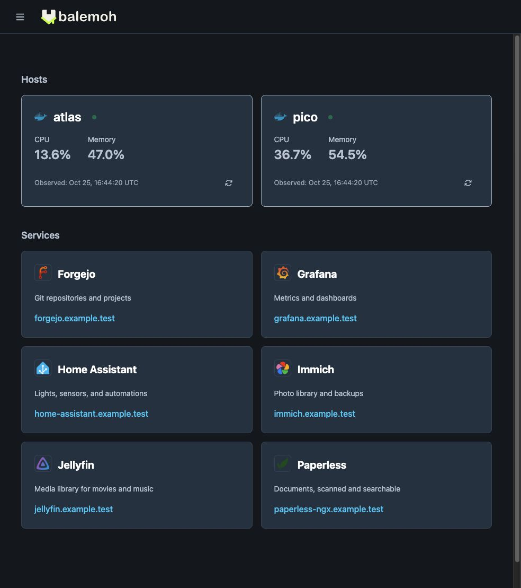
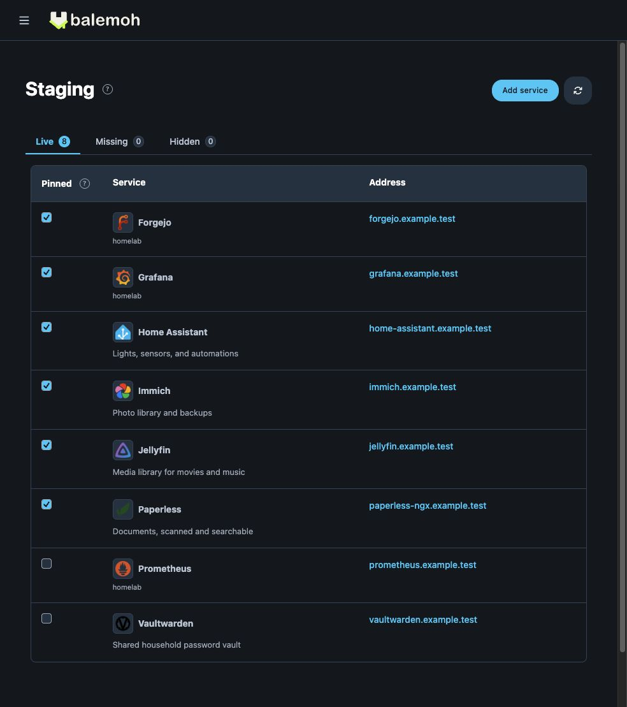
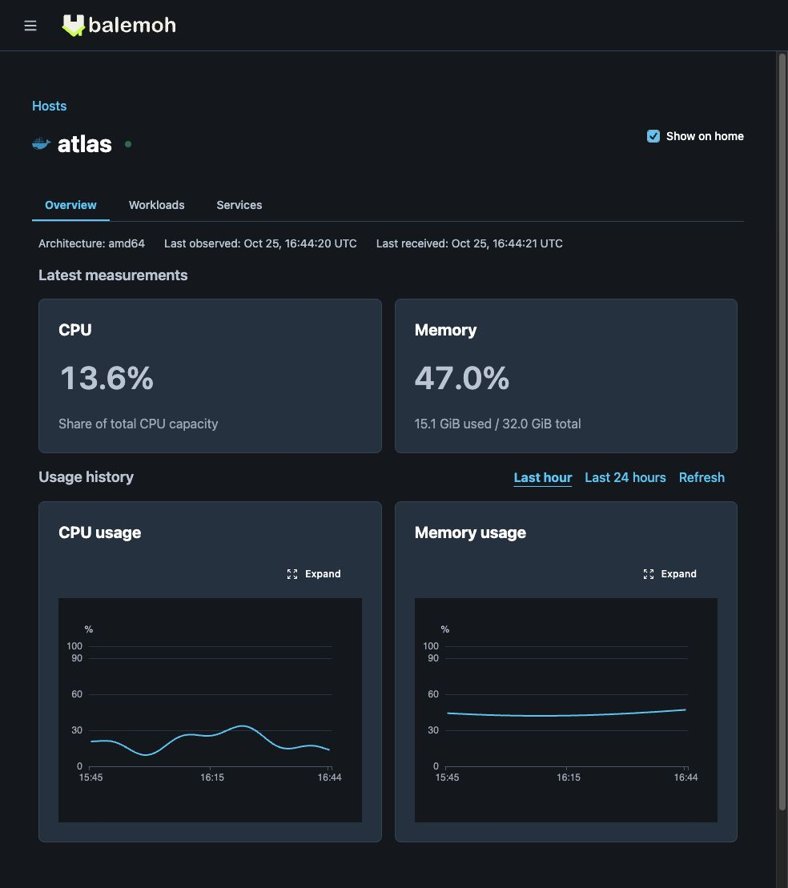

# Your homelab. One place to start.

Balemoh discovers your Kubernetes, Docker, and Podman services.
Choose what belongs on your homepage, then keep an eye on the hosts behind it.

- [Set up Balemoh](getting-started/index.md)
- [How discovery works](guides/discovery/index.md)

## Found automatically. Added by you.

A new container should not mean another bookmark to remember.
Balemoh collects services in Staging, where you can review their addresses
and pin the ones you want on your homepage.

Rename a service, add a description, or choose its icon.
Your choices stay put when discovery refreshes.

[Read the discovery guide](guides/discovery/index.md) or
[open the full-size screenshot](media/staging-synthetic.jpg).

Once services are on your homepage, press Command+K or Ctrl+K to find them by
name, description, or address. [Learn service search](guides/search/index.md).

## Check the host behind the service.

Open a host to see its workload inventory and reported runtime state.
With telemetry enabled, see CPU and memory readings on your homepage
and usage history on the host page. Missing observations appear as gaps.

[Enable basic host telemetry](guides/host-telemetry/index.md) for collection
setup, history controls, and reporting status.

## Different machines. The same starting point.

Keep an agent beside each container host or Kubernetes cluster.
Agents send authenticated discovery snapshots to your Balemoh gateway,
so services across your machines can share one homepage.

The gateway owns its pins. It does not need a remote Docker socket
or credentials for every cluster.

[Connect federated agents](guides/federation/index.md).

## Run it in your own homelab.

Start with one source and a few services. Add hosts and agents as you need them.
Balemoh runs on amd64 and arm64, with persistent state in SQLite.

Balemoh is an early v0.0.x project.
The guides cover installation, configuration, and keeping your instance private.

Balemoh builds are available at no charge from [GitHub releases](https://github.com/araihu/balemoh/releases).

[Install Balemoh](getting-started/index.md).
Building an integration? Browse the [OpenAPI reference](https://balemoh.araihu.com/openapi/catalogs/balemoh/documents/openapi/).
